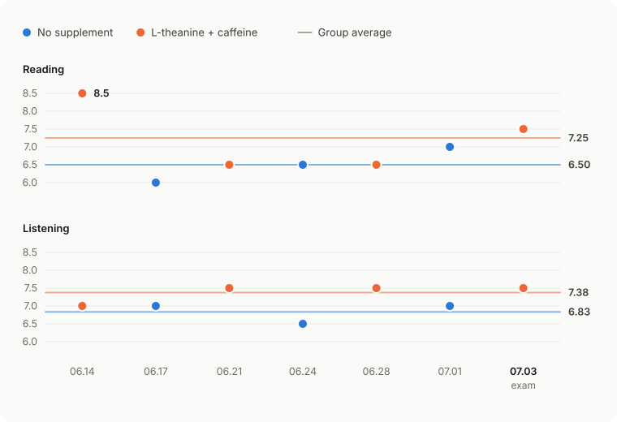

# An Unorthodox Focus Hack: Personal Observations on L-Theanine and Caffeine for IELTS

> **TL;DR:** I logged seven IELTS listening and reading sessions. For four of them I took L-theanine with caffeine; for the other three I took nothing. The last session was the real exam. On combination days my listening averaged 0.54 bands higher and my reading 0.75 bands higher, or 0.65 higher across both. But the only subject was me, and there was no randomization, no blinding and no placebo. All this shows is that I scored better on the days I took it. It can’t show that taking it is why.

## What It Might Do

L-theanine and caffeine together may make you more alert and steadier in your attention for a while, which is what I wanted for long stretches of concentration like IELTS listening and reading. Some randomized controlled trials have found small gains in speed or accuracy on certain attention tasks. The effect depends on the task and on when you’re tested, though, and it doesn’t show up reliably on every measure.

So the fairest way to put it is this: **the combination may smooth out fatigue and dips in attention, which can help you use the ability you already have. It is not a score-boosting pill, and it can’t stand in for language skills, sleep or practice.**

## What I Took and How I Kept Score

### The Doses

- L-theanine: about 200 mg per session, from a common, reputable brand.
- Caffeine: a target of about 100 mg, keeping L-theanine to caffeine at roughly 2:1.
- Caffeine source: Swanson guarana capsules. Guarana is a plant that contains caffeine naturally, and the capsules hold an extract of it.
- Tasks: IELTS listening and reading mock tests.

One thing I should say up front: the caffeine content of guarana can vary from batch to batch, **so the number of capsules can’t be converted into an exact caffeine dose**. If you want an experiment someone else could repeat, record the milligrams of caffeine printed on the label, not just how many capsules you took.

### The Log

The records cover two stretches: routine mock tests, then preparation for the real exam. I took the combination in four of the seven sessions and nothing in the other three, which served as the control. Each time I did the same kinds of IELTS listening and reading tasks and wrote down my scores.

| Date | Condition | L-theanine | Guarana | Reading | Listening |
| --- | --- | ---: | ---: | ---: | ---: |
| 06.14 | Combination | 2 capsules | 2 capsules | 8.5 | 7.0 |
| 06.17 | No combination | 0 | 0 | 6.0 | 7.0 |
| 06.21 | Combination | 3 capsules | 3 capsules | 6.5 | 7.5 |
| 06.24 | No combination | 0 | 0 | 6.5 | 6.5 |
| 06.28 | Combination | 2 capsules | 2 capsules | 6.5 | 7.5 |
| 07.01 | No combination | 0 | 0 | 7.0 | 7.0 |
| 07.03 (real exam) | Combination | 2 capsules | 2 capsules | 7.5 | 7.5 |

## Results

| Measure | Combination (4 sessions) | No combination (3 sessions) | Difference in means |
| --- | ---: | ---: | ---: |
| Reading | 7.25 | 6.50 | +0.75 |
| Listening | 7.38 | 6.83 | +0.54 |
| Both sections combined | 7.31 | 6.67 | +0.65 |

Across all seven sessions, I averaged higher in both sections when I’d taken the combination. The gap was bigger in reading; listening scores moved around less. The chart shows the score from every session, so the averages can’t hide how much individual tests differed.

And they differed a lot. The 8.5 in reading on 06.14 was my best score of the seven. Take it out and the combination group’s reading average falls to 6.83, just 0.33 above the control. One good day moving the mean that much is a reminder of how small this sample is.

Plenty of other explanations are still on the table, too. The test sets weren’t necessarily equally hard. Practice alone may have pushed my scores up. I didn’t control for sleep, mood or the time of day. And I always knew whether I’d taken it, which leaves room for an expectation effect. What the chart shows is **a correlation and a personal experience**, not cause and effect.

## Why It Might Work

Caffeine keeps you alert by blocking adenosine receptors. It usually chases away drowsiness, but it can also bring jitters, a racing heart, or focus that narrows too far. L-theanine is an amino acid found in tea, and some research suggests it can take the edge off caffeine’s tension and improve certain measures of attentional control. What you’re after with the pair is a steadier kind of alertness, not a bigger buzz.

The published evidence broadly fits that picture:

| Study | Design and dose | Main finding |
| --- | --- | --- |
| Haskell et al., 2008 | Randomized, double-blind crossover; 250 mg L-theanine + 150 mg caffeine | Improvements in some measures of reaction speed, working memory, and fatigue |
| Giesbrecht et al., 2010 | Crossover trial with 44 participants; 97 mg L-theanine + 40 mg caffeine | Attention was easier to sustain on demanding tasks |
| Einöther et al., 2010 | Randomized, double-blind crossover; 97 mg L-theanine + 40 mg caffeine | Better task-switching performance, though not every measure of attention improved |
| Williams et al., 2025 | Systematic review and meta-analysis | Small to moderate acute benefits on some attention tasks, depending on the task and timing |

These studies measured performance on lab tasks, not IELTS scores. They suggest the combination can help with attention; they don’t support any fixed gain in test scores.

## Safety Limits

1. Don’t try it for the first time on the day of the real exam. Test how your body reacts first, in a mock exam at the same time of day and at a similar intensity.
2. Caffeine can cause insomnia, anxiety, palpitations, an upset stomach and shaky hands. If you’re sensitive to it, take less or skip it.
3. The U.S. FDA says that for most healthy adults, 400 mg of caffeine a day is not generally associated with negative effects, but people vary a lot. That’s a safety ceiling, not a recommended dose.
4. Stay away from pure caffeine powder and highly concentrated caffeine liquids. They’re very hard to measure accurately, and an overdose can do serious harm.
5. If you’re pregnant, have heart disease, anxiety or a sleep disorder, or take any medication, talk to a doctor first. Supplements aren’t risk-free just because they’re supplements.

## If I Did It Again

Next time I’d keep the question source, time of day, sleep and diet as constant as I could, and decide in advance, at random, which days are combination days and which are control days. I’d record the actual dose in milligrams, how focused I felt, any side effects and my scores, and collect many more sessions. Ideally I’d also use identical-looking placebo capsules, labeled by someone else, to cut down the expectation effect.

For me, these seven sessions are reason enough to keep watching carefully, and nowhere near enough to claim the combination definitely raises scores. Reliable gains still come from language ability, timed practice and sleep. At most, L-theanine and caffeine might help you get a little closer to your normal best.

## References

1. [Haskell CF, et al. The effects of L-theanine, caffeine and their combination on cognition and mood. *Biological Psychology*. 2008.](https://pubmed.ncbi.nlm.nih.gov/18006208/)
2. [Giesbrecht T, et al. The combination of L-theanine and caffeine improves cognitive performance and increases subjective alertness. *Nutritional Neuroscience*. 2010.](https://pubmed.ncbi.nlm.nih.gov/21040626/)
3. [Einöther SJL, et al. Effects of L-theanine and caffeine on attention and task switching. *Appetite*. 2010.](https://pubmed.ncbi.nlm.nih.gov/20079786/)
4. [Williams JL, et al. The Cognitive Effects of L-Theanine and Caffeine: A Systematic Review and Meta-Analysis. 2025.](https://pubmed.ncbi.nlm.nih.gov/40314930/)
5. [U.S. Food and Drug Administration. Spilling the Beans: How Much Caffeine is Too Much?](https://www.fda.gov/consumers/consumer-updates/spilling-beans-how-much-caffeine-too-much)
