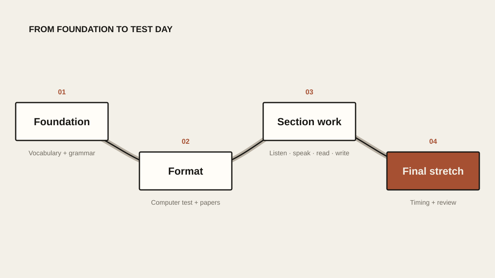
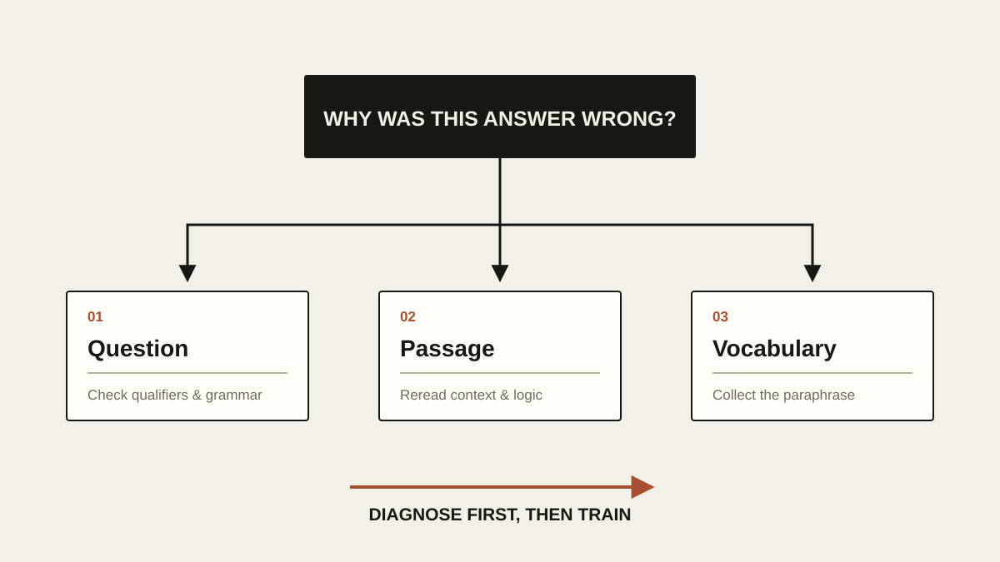
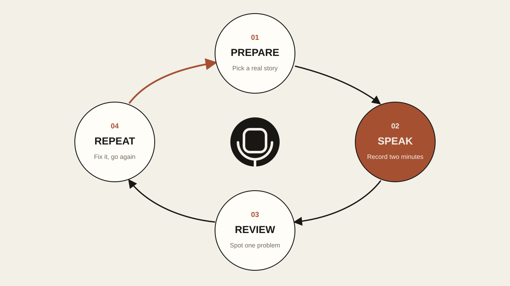

# IELTS on a Budget: A Zero-Cost Self-Study Guide

> I taught myself IELTS and got 7.0 on my first try without spending a cent. This guide collects the methods, resources and score benchmarks I used. These are my own views, not official standards, and I haven’t gone back to check that every website still works or how current the recalled-question banks are.

## The Toolkit

- **Computer-based mock tests:** ieltscat.xdf.cn
- **Essay feedback:** essay.art (free) and ielts9.me (paid)
- **Practice beyond the official books:** Xiahua Listening and ZYZ Reading

Xiahua and ZYZ are *ji jing*, collections of real exam questions that test-takers recalled and wrote down afterward, so there’s some chance you’ll meet one of them on the day. The Cambridge IELTS books are official practice tests published every year, and their questions won’t come up in the real exam. Even so, I’d finish the Cambridge books before touching *ji jing*.

## The Overall Plan

1. **Build a foundation:** vocabulary and grammar.
2. **Get to know the computer-based format and your materials:** pick a mock-test site and the Cambridge IELTS books.
3. **Work on each section:** listening, reading, writing and speaking.
4. **The final stretch:** strict timing, a close look at every mistake, and a run through the speaking question bank.

<!-- blog-image-agent:start id="ielts-study-roadmap" -->
<figure class="article-figure article-figure--agent" data-image-id="ielts-study-roadmap">
  
  <figcaption>Figure: Foundations first, then the test format, then each section, and strict timing at the end.</figcaption>
</figure>
<!-- blog-image-agent:end id="ielts-study-roadmap" -->

Don’t skip the foundation. Once the basics are solid, everything after it goes much faster. Depending on where you’re starting from, give it **two to six months**.

And one thing to keep in mind from day one: **at its heart, IELTS is a test of recognizing paraphrases.**

## Building the Foundation

### Vocabulary

Rough minimums to aim for:

| Target band | Reference vocabulary size |
| --- | ---: |
| 6.0 | 7,000+ |
| 6.5 | 7,500+ |
| 7.0 | 8,000+ |

What worked for me:

- Pick a daily load you can actually keep up. I reviewed about 300 words a day and ended up with a vocabulary of more than 9,000.
- Any mainstream vocabulary app will do, such as Shanbay or Bubei.
- The Daily English Listening app can estimate your vocabulary size.
- Check in every day, right up until a week before the exam.

### Grammar

Build it up in this order:

1. The five basic sentence patterns.
2. Conjunctions, to join simple sentences into longer ones.
3. Clauses.
4. Then the less central topics, such as the subjunctive.

What grammar should give you is the ability to spot the backbone of a long, tangled sentence quickly. Memorizing rules is beside the point.

A good self-test: ask an AI to generate some long sentences, mark the main structure yourself, then have the AI check and correct you.

For a free course, try 《半个月搭建你的语法体系》 (“Build Your Grammar System in Half a Month”) by the Bilibili creator “Larry 想做技术大佬.”

## Computer-Based Practice

### New Oriental’s IELTS Mock-Test Site

- Website: [ieltscat.xdf.cn](https://ieltscat.xdf.cn/)
- Covers listening, reading and writing mock tests.
- Great for getting used to the computer-based interface and the full flow of the test.

## Listening

### Daily Practice

- Find material at the right level in a listening app. I recommend **CNN 10**.
- After a Cambridge listening test, go back and do intensive listening: play a sentence, write it down, repeat. To be honest, I never tried this myself, but I’m told it’s how most people practise.
- Practise until your grammar reflexes get fast. Often the problem isn’t that the speaker is too quick, but that the meaning of the sentence doesn’t land in time.

### What Separates a 6 From a 7

- Band 6 listening leans on catching keywords.
- Band 7 listening means following what a whole passage is saying.

### Using the Past Papers

- Start with *Cambridge IELTS 10* and the books after it.
- The older *Cambridge IELTS 4–7* are fine for extra practice. Some of their questions don’t match today’s exam very well, so don’t worry too much about poor results on them.

## Reading

### Using the Past Papers

- Again, start with *Cambridge IELTS 10* and later.
- If you have time, the earlier books are worth doing too.

### Where Wrong Answers Usually Come From

1. **Misreading the question:** you skipped a word, or weak grammar led you to misunderstand what was being asked.
2. **Misreading the passage:** you missed part of a paragraph, or found the right sentence but didn’t understand it.
3. **Not enough vocabulary:** you didn’t recognize the paraphrase linking the question to the passage.

<!-- blog-image-agent:start id="ielts-reading-diagnosis" -->
<figure class="article-figure article-figure--agent" data-image-id="ielts-reading-diagnosis">
  
  <figcaption>Figure: Before redoing a question, work out why you got it wrong: the question, the passage or the vocabulary.</figcaption>
</figure>
<!-- blog-image-agent:end id="ielts-reading-diagnosis" -->

## What Listening and Reading Have in Common

- Get your vocabulary and grammar solid before you study test technique.
- For an online course, try the Bilibili creator “天狗吃月亮,” especially for marking keywords and spotting paraphrases.
- At first you can practise reading without a timer. If your accuracy is high when time doesn’t matter, your foundation probably isn’t the problem.
- Whether to time yourself from the start depends on you. But from two months before the exam, you must practise under the official time limits.
- Leave Xiahua Listening and ZYZ Reading until you’ve finished the Cambridge books. The Cambridge books alone are enough to prepare you for the real exam.

## Writing

### How to Study

- Search for **Simon** on Bilibili and learn his four-paragraph structure, plus the different question types for Task 1 and Task 2.
- Opinions on Simon’s system vary online, but I used his templates and scored 6.5 in writing. For most candidates, that’s already enough.

### Essay Feedback

- [essay.art](https://essay.art/): completely free. My essays usually got 6.0 there; my real writing score was 6.5.
- [ielts9.me](https://ielts9.me/): the first essay is free, after that you pay. Its scores are more accurate.

## Speaking

- Once your grammar and vocabulary are in place, find people from other countries to chat with on an online platform and practise real conversation.
- If you get nervous at first, have an AI give you a topic and record yourself talking into your phone.
- Start working through the speaking question bank a month before the exam. I used IELTS Bro (雅思哥).
- Never memorize other people’s answers. Wherever you can, answer from your own experience.
- The test has three parts. Part 1 is everyday questions. In Part 2 you get a topic, one minute to make notes, and then two minutes to talk. Part 3 digs deeper into related issues. To me, **Part 2 matters most**: speak for at least 1 minute 40 seconds, and ideally the full two minutes.
- Collect the speaking questions and send them to an AI, and ask it to suggest material and expressions based on your own life. Because it can draw on your chat history, it may turn up a Part 2 story that fits, sometimes one you’d forgotten you had.
- If you can, avoid sitting the speaking test during a question-change season. These usually come in **January, May and September**.

<!-- blog-image-agent:start id="ielts-speaking-cycle" -->
<figure class="article-figure article-figure--agent" data-image-id="ielts-speaking-cycle">
  
  <figcaption>Figure: Pick a real story, speak for two minutes, listen back, fix one thing, and go again.</figcaption>
</figure>
<!-- blog-image-agent:end id="ielts-speaking-cycle" -->

## The Timeline

| Stage | What to do |
| --- | --- |
| Foundation (about 2–6 months) | Build vocabulary and grammar; practise untangling long, difficult sentences |
| Every day | Vocabulary review, intensive listening, reading post-mortems, speaking practice |
| Two months out | Start strict timed practice for reading and listening |
| One month out | Work through the speaking question bank, building answers around your own experiences |
| One week out | Drop the daily vocabulary check-in; focus on getting into good shape and reviewing everything |

## A Few Last Words

Looking back, only a handful of things really made the difference. Foundation first: without solid vocabulary and grammar, no technique works reliably. Build your skill on real past papers: finish the Cambridge books before reaching for anything else. Be specific when you review: for every wrong answer, work out whether it came from vocabulary, grammar, comprehension, locating information or time. And in speaking, tell the truth: skip the memorized templates and build your answers around your own life.

Above all, it comes down to execution. Finishing your first full practice test, or saying your first sentence of English out loud, is already the step that matters most. Getting each day’s work done usually beats endlessly hunting for new materials and new tricks.
