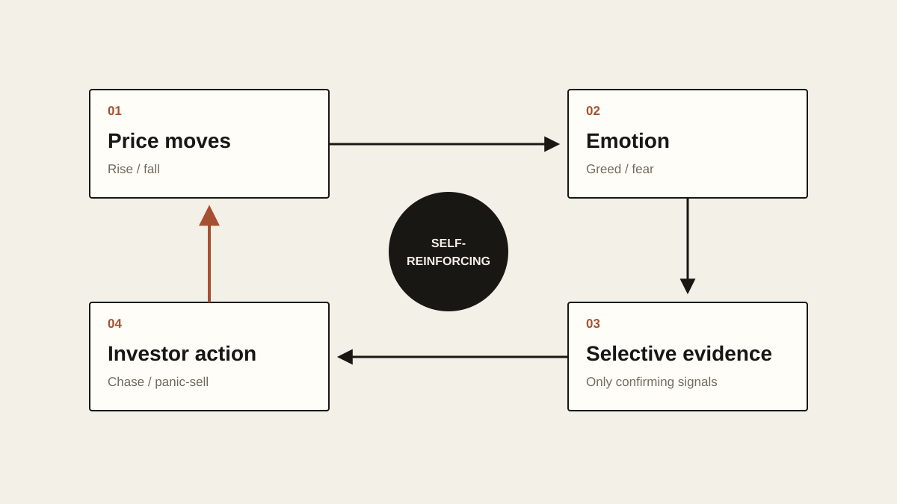

# The Psychology of Investing

When something in a supermarket drops from 100 yuan to 70, most people think they’ve found a bargain. Same product, lower price, more reason to buy.

Markets often run the other way. An asset climbs from 100 to 150 and people start to think it might be worth owning. At 200, more of them are talking about it. At 300, even people who never cared begin doing their homework. Only when everyone around them seems to be making money do many finally talk themselves into it: “Okay, this thing really is good.”

On the way down, the film runs backward. They like it at 100, start to wonder at 90, go back over the risks at 70, and at 50 they suddenly find it riddled with problems. Then they sell, on the gloomiest day of all.

If nothing about the asset has changed, that’s a strange way to behave. It gets more expensive and people like it more; it gets cheaper and they like it less. Investing may be one of the few markets where raising the price brings in more buyers. That’s a big part of why I’ve come to believe the hard part of investing was never analyzing the asset. It’s analyzing yourself.

## A Different Brain on the Way Down

Before they put any money in, most people believe they’re rational. They read the financial statements, study the industry, follow the economy, work out a valuation and set an entry price. They even tell themselves, quite sincerely, “If it drops, I won’t panic.”

That’s easy to say while the market is calm. The drop itself is another matter. When the 100,000 yuan in your account turns into 80,000, something in your head starts to bend. What you used to call “short-term volatility” now goes by “risk.” The bad headlines you once scrolled past are suddenly impossible to ignore. Small problems you’d waved away look enormous overnight. You start hunting for bearish takes, reading one after another, until one day you can’t stand it anymore and you sell.

The moment you sell, you usually feel relief. That relief tells you something: a lot of selling doesn’t solve investment risk at all. It solves pain.

We are acutely sensitive to losses. The pleasure of making 10,000 yuan rarely makes up for the sting of losing 10,000. Say an investment rises from 100,000 to 120,000 and then slides back to 100,000. On paper you’re right where you started, but it rarely feels like nothing happened. It feels like you lost 20,000, because somewhere along the way that 120,000 quietly became your money.

Unrealized gains turn into private property in the mind long before anything is sold. So when the price slips from 120,000 to 110,000, your brain doesn’t say, “I’m still up 10,000.” It says, “I just lost 10,000.” If the price keeps falling, the pain keeps piling up. Eventually your decisions have little to do with future returns and a lot to do with a much simpler question: what would make me feel better right now?

## Greed Never Introduces Itself

It works the same way on the way up. When an asset first starts to rise, people are cautious. The more it rises, the less cautious they get. Someone who once thought 10 percent a year was excellent starts treating 20 percent as normal after a good run. Someone who planned to sell at a 30 percent gain gets there and starts thinking about 50. At 50, the question becomes: why not double? The finish line keeps moving back, and that’s what makes greed so slippery.

Greed doesn’t walk in and announce itself. It arrives dressed as a perfectly reasonable argument. “The fundamentals have improved.” “The market is bigger than I thought.” “This time is different.” “The trend is so strong that if I sell now, I may never get back in.” Any one of these might be true. The danger is how hard it is to tell whether you’re reassessing the facts or simply feeling better because the price went up.

Prices don’t only change how much you have. They change how you read the world. While an asset is rising, good news is easy to believe. A new product means huge growth ahead. A new policy confirms the long-term trend. Institutional buying is the smart money giving its blessing. A competitor dropping out means the industry is getting healthier. Once the same asset starts to fall, the same events get retold. The product might flop. The policy is uncertain. The institutions were probably just trading. Competition is only going to get worse.

Often the facts haven’t changed at all. Only the price has. The price changes your mood, your mood decides which information gets through, and the information that gets through proves your mood was right. From the inside, that loop is almost impossible to see.

<!-- blog-image-agent:start id="investment-feedback-loop" -->
<figure class="article-figure article-figure--agent" data-image-id="investment-feedback-loop">
  
  <figcaption>Figure: The price moves, the mood follows, the mood picks the evidence, and the next trade pushes the price again.</figcaption>
</figure>
<!-- blog-image-agent:end id="investment-feedback-loop" -->

We like to think we look at the evidence first and form an opinion afterward. More often the opinion shows up first, and then we go looking for evidence. In a rising market, a holder collects every reason it should keep rising. In a falling market, the same person collects every reason to sell. The internet makes this much worse, because whatever you want to prove, there’s more than enough material to prove it. Think the market is headed up? Dozens of bullish reports are waiting for you. Think it’s about to crash? There are dozens of tightly argued bearish ones too. There is far too much information now for information alone to give you an answer. Most of what people see in the market is the part of reality they’re willing to see.

## The Market Doesn’t Know What You Paid

Then there’s your cost basis, which is a fascinating thing.

People get almost sentimental about the price they paid. Buy at 100, watch it fall to 80, and the thought that comes up most often is, “I’ll sell when it gets back to 100.” It sounds completely natural. Look at it closely and there isn’t much logic in it. The market doesn’t know you paid 100. Neither does the company’s management, or anyone else trading it. The company’s future cash flows won’t move a cent because of what you paid.

If the asset is now worth only 50, climbing from 80 back to 100 doesn’t become more reasonable just because you once bought it at 100. If it’s really worth 200, selling at 100 because you’ve “broken even” makes no more sense. A cost basis is a historical record, nothing more. In your head, though, it quickly becomes an anchor, and gains and losses get redefined around it. An asset at 80 isn’t red or green in itself. Put “-20%” next to it in a trading app and it suddenly feels completely different.

Much of the time we aren’t judging what something is worth. We’re judging how far it is from *my price*.

## When Everyone Else Is Making Money

A bull market has another powerful force: watching other people get rich.

Losing money hurts, of course. But watching others make money while you make none can hurt too. Maybe you had no plans to buy something. A friend makes 30 percent, and you shrug. Another makes 50. Social media picks it up, the news starts covering it, and more and more people post screenshots of their gains. One day you start to wonder whether you’ve missed something. The higher the price goes, the stronger that feeling usually gets. By the end, the expected return barely figures in. People buy because they can’t stand the thought of being left on the platform for good.

The memory-chip rally in the first half of this year gave me a serious case of FOMO. Whether I was on Douyin or Twitter, it only took a few posts or videos to find people showing off their trades. Some had made several times their money on SanDisk, SK hynix and Micron. But I didn’t feel I understood the industry, so in the end I didn’t buy.

That’s also why so many people ignore an asset when nobody wants it and only develop a burning urge to research it after it has gone up several times over. A rising price creates its own credibility.

We lean heavily on the judgment of the group, and in everyday life that usually works. A long line outside a restaurant generally means the food isn’t bad. A product with 100,000 good reviews is generally a safer bet than one with none. Markets have a catch. When everyone buys because other people are buying, their buying pushes the price up further. The rise becomes proof of the rise, more people pile in, and eventually the price itself is the strongest argument there is.

The same thing happens on the way down. Everyone is selling, so the price falls. The falling price seems to prove the risk is real, so more people sell. Crowds can produce mania and panic alike. And the people inside a crowd almost never feel they’re following it. They feel they’ve reached their own independent conclusion.

## Comfort Is Usually Expensive

We also love to assume that whatever happened recently will keep happening. After a market has climbed for a few years, people treat rising prices as the natural state of things. After a year of falling, they feel the bad times will never end.

History has run this play countless times. When prices are at their best, the news usually looks its best too: profits are growing, the economy is booming, confidence is high, and everyone can find a reason to stay optimistic. When prices are at their worst, things often really are bad: recession, layoffs, one piece of bad news after another, and everyone can find just as many reasons to stay gloomy.

That’s what makes investing so counterintuitive. A genuinely cheap asset almost never feels safe. If every problem had been solved and everyone felt confident, it probably wouldn’t be cheap anymore. Expensive moments, meanwhile, tend to feel wonderful. Your account goes up every day, the headlines are good, the people around you are making money, and the future looks bright. Risk rarely shows up wearing a T-shirt with RISK printed across the front. More often it looks like certainty.

Making money also makes us overrate ourselves. Someone who gets their first three trades right rarely concludes, “Maybe I was lucky.” The more common thought is, “I think I’m actually good at this.” So 10,000 yuan becomes 50,000. Simple assets give way to complicated ones. Leverage, which they once wouldn’t touch, starts to seem fine in small doses.

Profit brings more than money. It brings confidence, and confidence makes you willing to take more risk. That’s why making a lot of money early can be one of the most dangerous ways to start. A loss at least forces you to question your method. A winning streak can convince someone who has never been through a full market cycle that they’ve cracked some kind of code. By the time real volatility arrives, they may be carrying far more risk than they ever did at the start.

## One Centimeter, One Hundred Meters

So talking about “mental toughness” isn’t enough. An investor’s psychology is shaped, to a large degree, by position size.

A 30 percent drop in a 10,000-yuan position and a 30 percent drop in your entire savings are two completely different psychological experiments. The first might make the asset look cheaper. The second might have you refreshing quotes at three in the morning.

In theory, the same person should reach the same judgment about the same asset. In practice, change the position size and you can end up with a different person. Every dip pushes some real goal a little further away: the down payment on a home, a child’s tuition, years of savings, retirement. Once those things are tied to a number on a screen, even a calm person will struggle to treat it as a math problem.

A lot of what we call investment psychology is really risk management. If an ordinary fluctuation is enough to make someone abandon their whole investment thesis, the problem may not be weak willpower. The position may simply have been too big from day one. Picture a board one centimeter off the ground: anyone can walk across it. Lay the same board between two buildings, one hundred meters up, and your whole body locks. Your sense of balance hasn’t vanished. What’s changed is the cost of a mistake.

<!-- blog-image-agent:start id="investment-high-wire" -->
<figure class="article-figure article-figure--agent" data-image-id="investment-high-wire">
  
  <figcaption>Figure: Same board, same sense of balance; only the cost of a slip has changed. Position size does the same thing to judgment.</figcaption>
</figure>
<!-- blog-image-agent:end id="investment-high-wire" -->

Investing works the same way. Plenty of people are perfectly rational in a paper-trading account and turn into someone else the moment real money is involved. There’s nothing strange about that. Real money brings real emotion.

## A Contract With Your Future Self

That’s why I’ve always thought “stay rational” is close to useless as investment advice. Nobody becomes irrational because they didn’t know they were supposed to be rational. No one needs lessons in fear during a crash, or in greed during a long rally.

These reactions are far older than financial markets. Fear kept our ancestors away from danger. Sticking with the group improved the odds of survival. Loss aversion made people protect what they already had. In the wild, reacting fast to the latest information probably worked better than slowly building a probability model. The trouble is that we’ve carried a brain built for survival into a market built from numbers, probabilities and long-term compounding. Instincts that once kept us alive can turn into weaknesses here.

So the most useful approach probably isn’t trying to become someone without emotions. Those people barely exist. The realistic approach is to accept that the emotions will come, and to set the rules in advance so they have less power when they do.

Before you buy, answer a few questions. Why am I buying this? What exactly do I see in it? What would prove me wrong? What’s the most I’m willing to lose? If this position were cut in half, would it affect my normal life? If the price rises a lot, has the value actually changed, or only the price? If the price falls a lot and my original reasoning still holds, what will I actually do?

Those questions are easy to answer before you buy, while money hasn’t yet started working on your emotions. Once you own the thing, they get much harder. People start revising their answers, and they almost never admit that’s what they’re doing.

That may be the most important job an investment plan has. It isn’t there to predict the future; nobody can. It’s closer to a contract, written by your calm past self for your emotional future self. After a rally, that future self may believe everything can keep going up. After a crash, the same self may believe the world is ending. If you let each moment’s mood rewrite the rules, you don’t have a strategy at all. You have reflexes.

None of this means you should cling to your first opinion forever. Refusing to admit a mistake isn’t discipline. If new facts show you were wrong, changing your mind is the right call. The hard part is telling things apart. Did the facts change, or only the price? Did the thesis break, or does losing money just hurt? Is the asset really becoming more valuable, or do you want to believe it is because you’ve made money on it?

That may be one of the hardest questions in investing, because you’re both the judge and the defendant. You have to decide whether your judgment has been bent by emotion, and the one doing the deciding is the same brain.

So I don’t believe that memorizing a few terms like loss aversion, confirmation bias and anchoring is enough to beat them. Knowing you have a bias doesn’t make it go away. Most of us know staying up late is bad for us, and we stay up anyway. Knowing sugar is bad for you doesn’t stop you wanting the cake when it shows up. We’re wired to chase what feels good and avoid what hurts, and investing is no exception.

Theory is easiest to understand after the market closes. The real exam begins when your account is shrinking every day, or when everyone around you insists that this time really is different.

In the end, the contest that matters in investing may be the one between you and yourself. The market just keeps quoting prices. The fear, greed, regret, hope, envy and confidence all come from you. When prices rise, there’s a version of you that keeps getting greedier. When they fall, there’s one that keeps getting more frightened. After a few wins, there’s yet another, quietly convinced you’re smarter than everyone else. They all live in the same body, and each runs on a completely different investment logic.

The person on the other side of your trade is never just someone else in the market. It’s also your future self.

A good investment system doesn’t have to call the next rise or fall. Its more important job is to settle the rules before that other version of you shows up, so that it doesn’t get the final say.

Because the market’s real talent was never taking people’s money. It changes how they feel first, and then lets them make the losing decision with their own hands.
