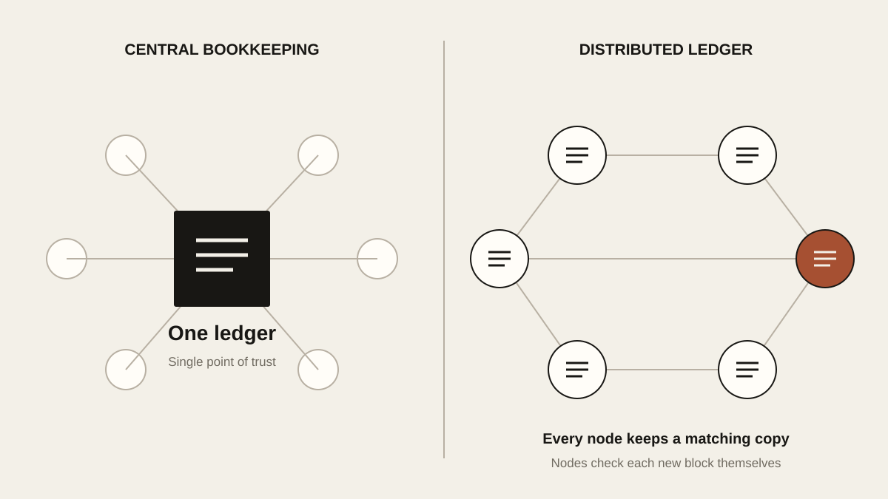
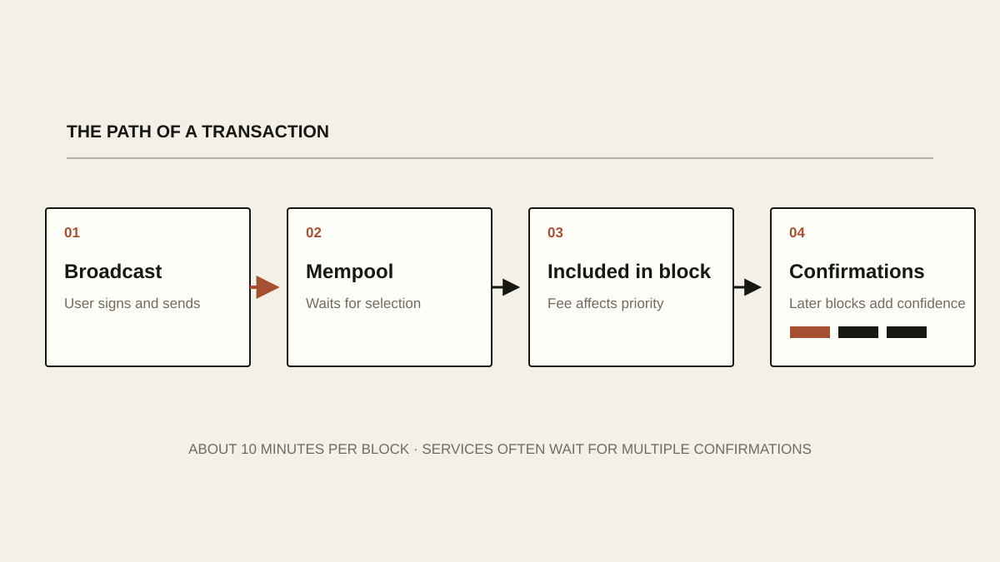
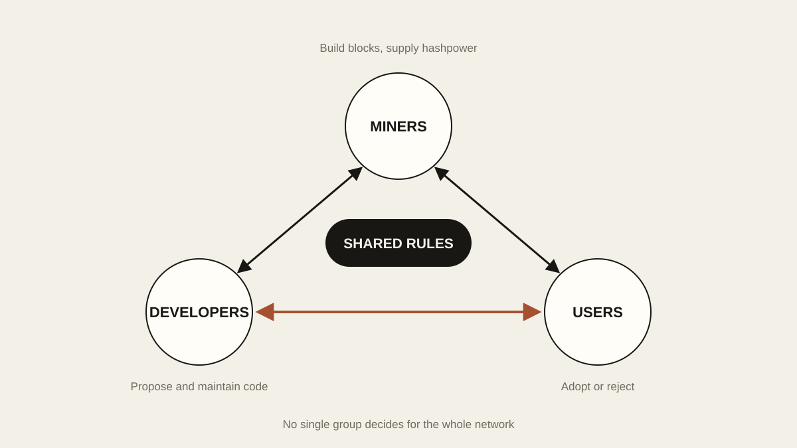

# What Is Bitcoin?

Bitcoin still has an air of mystery about it. A single coin is worth tens of thousands of dollars and nearly every institution and investor has heard of it, yet very few people understand how it actually works. Plenty of people can’t see why it should be worth so much, and some are convinced it was invented as a scam, a Ponzi scheme from day one.

I have my own way of picturing it: Bitcoin is a utopian company built by a huge number of equal “employees.” It makes exactly one product, a currency unlike any other, and along the way it offers a whole new way to save. In this piece I want to explain it with as little jargon as I can, so that even a complete beginner comes away knowing what Bitcoin really is.

## A Ledger Everyone Keeps

Put simply, Bitcoin is a distributed ledger.

Traditionally, the books are kept by one person or one institution, such as a bank or a brokerage. Whoever holds the ledger is the one you have to trust, and that’s where the trouble starts. Companies cook their books. Banks refuse to pay out deposits. In 2022, several rural banks in Henan did exactly that: depositors couldn’t get their money out, the banks wouldn’t acknowledge it, and some of the people who went to demand it back were beaten.

Bitcoin does it differently. The ledger doesn’t belong to any institution. Thousands upon thousands of nodes around the world each keep a full copy and maintain it together, and every one of them checks each new block on its own. Anything that breaks the rules is simply rejected. Nobody is in charge, so there’s nobody you have to take on faith.

<!-- blog-image-agent:start id="bitcoin-ledger-topology" -->
<figure class="article-figure article-figure--agent" data-image-id="bitcoin-ledger-topology">
  
  <figcaption>Figure: A bank keeps one ledger that everyone has to trust. Bitcoin gives every node its own copy and lets each one check the new blocks.</figcaption>
</figure>
<!-- blog-image-agent:end id="bitcoin-ledger-topology" -->

## Blocks, Mining and Confirmations

The ledger is written one page at a time, and each page is called a block. Every block points back to the one before it, so they form a chain: the blockchain you’ve heard so much about. Each block records a batch of transactions, such as “A sends B one BTC,” and a block usually holds a few thousand of them. As I write this, on August 1, 2026, the chain is closing in on one million blocks.

Mining is the race to write the next page. Miners run specialized machines that hash the block’s data over and over (think of a hash as a digital fingerprint), hunting for a result that meets the network’s difficulty target. Whoever finds one first gets to add the block, and collects the newly issued bitcoin plus the fees from that block’s transactions.

All of this burns an enormous amount of electricity, and that’s exactly where Bitcoin’s security comes from. To rewrite the ledger, an attacker would need more than half of the network’s total computing power, which makes an attack absurdly expensive. Every 2,016 blocks, roughly every two weeks, the network adjusts the mining difficulty to match the total computing power, keeping the average time between blocks at about ten minutes.

A transfer usually takes 20 to 30 minutes to arrive, because many exchanges and apps wait for around three confirmations before they trust it. Getting into a block counts as the first confirmation, and each new block after that adds another. Users set their own fees, and miners pick the transactions that pay more first.

<!-- blog-image-agent:start id="bitcoin-transaction-path" -->
<figure class="article-figure article-figure--agent" data-image-id="bitcoin-transaction-path">
  
  <figcaption>Figure: A transaction is broadcast, waits in the mempool, gets picked into a block, and gains a confirmation with every block after that.</figcaption>
</figure>
<!-- blog-image-agent:end id="bitcoin-transaction-path" -->

## Who’s in Charge?

Besides miners, the network has two other groups: developers and users.

Developers maintain Bitcoin’s software. They propose improvements in the community, and a change only makes it into the code once it has broad support. Most proposals never get that far, which is a good thing. Bitcoin has an enormous number of users, and changing the rules every other week would make the network anything but stable. Developers disagree with each other, users disagree with each other, and one group’s wishes can’t simply be pushed onto everyone else.

So the truly big upgrades can be counted on one hand. Segregated Witness (SegWit), proposed in 2015 and activated in 2017, moved signature data out of the main body of a transaction so the old 1 MB block could carry more of them. Taproot, in 2021, took another step forward on privacy and efficiency. The Lightning Network often gets mentioned in the same breath, but it isn’t a change to Bitcoin itself. It’s a second-layer network built on top of Bitcoin, launched in 2018, that lets small payments settle almost instantly.

2017 also brought a split. The community was locked in a bitter fight over scaling. One camp thought the blocks were too small and transactions too slow, so they forked off a new chain, Bitcoin Cash (BCH), which launched with an 8 MB block limit and later raised it to 32 MB. The other camp worried that bigger blocks would make it harder for ordinary people to run their own nodes, pushing the network toward centralization.

Users are where the ecosystem ends up. Whether to buy bitcoin and whether to use it is ultimately their call. If computing power fell sharply for some reason and the network grew less secure, users could stop using it, and developers would look for fixes. If developers were captured by big money and rewrote the rules in favor of the powerful, miners could refuse to mine, users could refuse to upgrade or to buy, and the price would fall. A falling price, in turn, makes attacking the network even less worthwhile. Nobody wants to do that much work for so little.

2017 offers a ready-made example. A group of large companies and mining pools signed an agreement to double the block size after SegWit, a plan known as SegWit2x. Users and node operators wouldn’t go along, and that November the plan was called off.

Miners, developers and users draw their power from different places and keep each other in check, a little like a delicate separation of powers. Bitcoin won’t die just because one of the three falls apart.

<!-- blog-image-agent:start id="bitcoin-governance-balance" -->
<figure class="article-figure article-figure--agent" data-image-id="bitcoin-governance-balance">
  
  <figcaption>Figure: Miners, developers and users each hold a different kind of power, so none of them can force rules on the rest.</figcaption>
</figure>
<!-- blog-image-agent:end id="bitcoin-governance-balance" -->

## Twenty-One Million

What matters even more is that the total supply of bitcoin is fixed by its code at 21 million. No person and no institution has the power to issue more. To my mind, that brings it very close to an ideal currency.

Spend any time with monetary history and you’ll see how precious that is. There are the Gold Yuan notes the Republic of China government issued in 1948, close to worthless within a year. There’s the Turkish lira today. And there’s the Iranian rial, whose exchange rate recently collapsed because of the war between the United States and Iran. If I tried to list every currency in history that has gone the same way, I’d be at it all day.

## Money Nobody Can Freeze

As long as you look after it properly yourself, no third party can freeze your bitcoin.

That’s a sharp contrast with the way some banks behave. If a modern bank suspects something questionable in your account, freezing it takes no effort at all. That can protect customers, but it can also cause an awful lot of trouble.

## About the Volatility

Last, a word on the price swings. Bitcoin trades around the clock, all over the world, with no daily price limits and no circuit breakers, so its price moves violently. On some days it swings more than 10 percent. Anyone thinking of investing in it needs to keep their position size under control, or it won’t be kind to their heart.

Personally, though, I don’t think the volatility matters much. Stretch out the price chart of any asset far enough and you won’t find one that has escaped huge swings. The Nasdaq lost nearly 80 percent after the dot-com bubble burst, and if you trace the S&P 500 back to the Great Depression, its fall was deeper than 80 percent. Plenty of investors call Bitcoin risky while betting, at the same time, that the “stable” assets will never let them down.

To me, Bitcoin’s high volatility is actually a good thing. It creates a naturally antifragile structure, where a steady run of small losses heads off a much bigger one later. If the idea of antifragility is new to you, I recommend Nassim Nicholas Taleb’s *Antifragile*. For any investor, it’s a genuinely important book.
