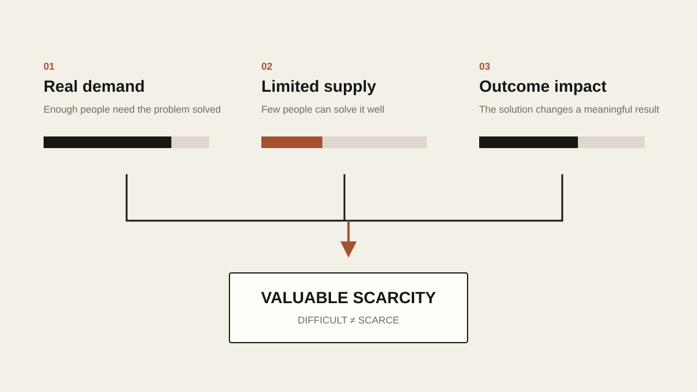
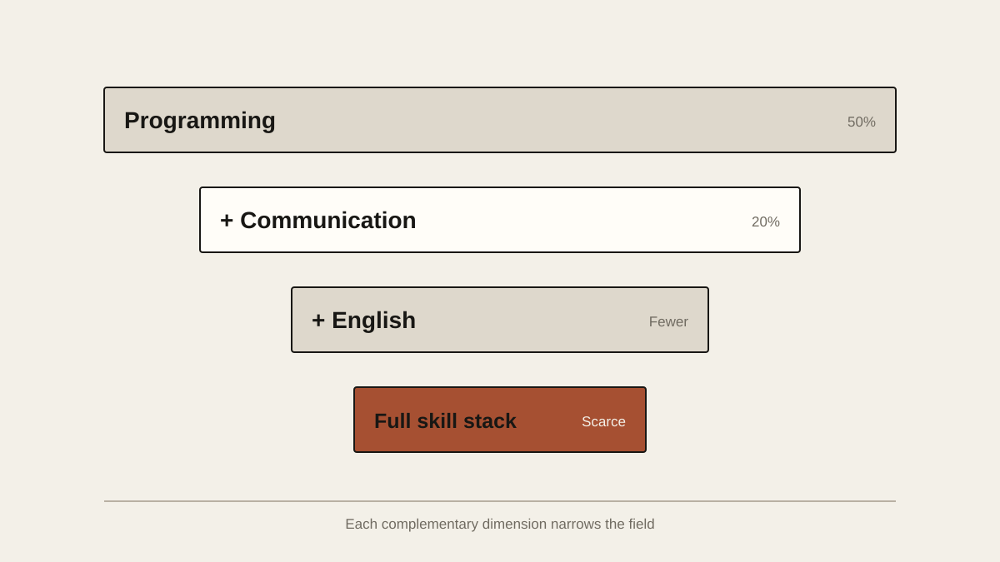

# What Makes a Skill Scarce?

Job hunting lately has made one thing harder and harder to ignore: there are already far too many people who can do things.

Open a job app, click on any half-decent position, and hundreds of applicants is nothing unusual. A fresh graduate can use Office, edit video, put together slides, write a bit of Python and Java, has passed China’s CET-4 and CET-6 English exams, and can get ChatGPT to help with code. Fifteen years ago, that would have been a pretty capable graduate. Today it describes an entirely ordinary one.

People haven’t gotten worse. If anything, the problem is that everyone can do so much, and mostly the same things.

That sounds backwards. School teaches us to keep picking up skills, on the theory that the more you can do, the more competitive you are. The market plainly doesn’t work that way. It won’t pay you more because something was hard to learn, or because you lost a lot of sleep learning it. The question it cares about is almost brutally simple: why should it be you?

Say a job gets 1,000 applications and 700 of the applicants know Java. Knowing Java is certainly a skill, but it’s hardly an advantage anymore. Now suppose the other 300 know Python as well as Java. Python doesn’t magically make them valuable either, because the people they’re really up against are the other 299 who look just like them.

When people can’t find work, the first instinct is usually to stack on more skills. Java isn’t enough, so they learn Python. Python isn’t enough, so it’s Go, then Docker, Kubernetes, Redis, microservices. The résumé keeps getting longer. The person doesn’t get noticeably more expensive.

It’s a lot like investing. What something is worth never depends on how much effort went into making it. It depends on how many people want it and how many can supply it. Diamonds aren’t expensive just because mining them is hard work, and nobody pays for a roadside rock because it’s heavy to carry. Skills are goods too. Once that clicks, a lot of strange-looking things stop looking strange.

Photography used to be a craft. You had to understand exposure, shutter speed, ISO, lenses and composition, then buy a pile of expensive gear. Today someone who knows nothing about photography can take a phone picture that a keen amateur twenty years ago would have struggled to match. Video editing went the same way. Making a decent video once meant learning Premiere or Final Cut and studying timelines, transitions and color grading. Then came Jianying, the Chinese app known abroad as CapCut. Now AI can generate captions, cut the pauses, pick the music, and even produce a video straight from text.

Programming is going through the same thing.

I studied computer science, so I feel this one more than most. A few years ago, being able to build a whole website, database to backend to frontend, still counted as a clear technical skill. Getting AI to build a website now is nothing to brag about. You don’t even need to really understand React or Vue. Have a rough idea of what you want, talk it through with an AI for a few hours, and you’ll probably end up with something that runs.

None of this means programmers are going to disappear, or that programming has no value. What’s happening is that “can write code,” on its own, is losing value, and that’s a very different claim. The Industrial Revolution didn’t end manufacturing; it lowered the value of a lot of purely manual labor. Excel didn’t kill finance; it stripped the premium off a lot of calculation done by hand. AI won’t wipe out knowledge work either. What it squeezes first, most likely, is the premium on mental work that is already highly standardized, easy to describe and easy to repeat.

Once a skill can be clearly described, systematically taught and objectively graded, it’s easy to mass-produce. And mass production is exactly what universities are good at. Write a textbook, set a syllabus, design an exam, then turn out hundreds of thousands of people with similar knowledge every year. So when I see a headline like “This major is red-hot” or “This field will be short millions of workers,” my first reaction is no longer to rush out and learn it. I ask a different question: if everyone knows there’s a shortage, will there still be one in five years?

A publicly known opportunity rarely lives long. When internet companies paid big salaries, crowds of people went off to study computer science. When content creation started making money, crowds started making short videos. Now that AI is hot, almost everyone wants to learn AI. That’s perfectly normal. High prices attract supply. The more money something makes, the more people pour in, and the faster its scarcity disappears.

## Hard Is Not the Same as Scarce

That’s why I think the skills worth learning aren’t the hard ones but the scarce ones, and people mix the two up all the time. Advanced mathematics is hard, but mastering it doesn’t guarantee anyone will pay you well. There’s plenty of obscure, intricate knowledge that maybe a few hundred people understand. If nobody needs it, it’s still worth very little.

Scarcity only counts when there’s demand alongside it.

Ten thousand people urgently need a problem solved and only a hundred can solve it: that’s scarcity with value. So when I decide whether a skill is worth learning now, I look at three things. How many people need it? How many people can provide it? And once you have it, how large an outcome can it affect?

<!-- blog-image-agent:start id="scarcity-demand-supply-impact" -->
<figure class="article-figure article-figure--agent" data-image-id="scarcity-demand-supply-impact">
  
  <figcaption>Figure: Being hard to learn isn’t enough. A skill pays when many people need it, few can supply it, and it changes an outcome that matters.</figcaption>
</figure>
<!-- blog-image-agent:end id="scarcity-demand-supply-impact" -->

Follow that logic far enough and you start to suspect that the scarcest things in the future won’t be a particular piece of software or a particular programming language at all.

## Finding the Real Problem

AI is very good at answering questions, as long as you know what to ask.

Picture a company announcing, “We’re going to use AI to cut costs and boost efficiency.” It sounds unimpeachable and says almost nothing. An ordinary employee might dive straight into large language models, agents and RAG, then produce a fifty-slide deck on how powerful AI is. A genuinely valuable one might go and look at how the business actually runs first. What does customer service really cost? Which step wastes the most people? Where is the error rate highest? Does this problem need AI, or would a fifty-line script do? Is it possible the company’s real problem isn’t efficiency at all, and nobody wants the product?

Plenty of people can answer questions. Far fewer can find the question that matters. As AI makes answers cheaper, questions get more expensive.

## Judgment

The internet is not short of information. Thinking about a stock? AI will write you a report thousands of words long in a minute. Looking for a job? It can size up ten companies. Want to start a business? It’ll list a hundred business models in one go.

Then what? Is the asset actually worth buying? Should you take the job? Will anyone really pay for the business? AI can give you twenty reasons for and, a second later, twenty reasons against. Someone still has to press the button.

The cheaper information gets, the more judgment matters. Information used to be a barrier in itself; some people made money simply because they knew something others didn’t. That edge is vanishing fast. What will separate people may no longer be whether they can find the information, but whether, with everyone holding roughly the same information, they can reach a better conclusion.

The annoying thing about judgment is that there’s no Judgment 101 you can pass and get a certificate for. It comes mostly from years of experience, failure and feedback, and from being willing to admit, again and again, that you got something wrong. Lots of abilities improve quickly with practice. Judgment tends to grow only after the real world has shoved your mistakes in your face, over and over.

## Owning the Outcome

The next one barely counts as a skill in the traditional sense: taking responsibility.

I used to find it odd that some managers were paid so much. Some of them didn’t seem to do anything concrete. They didn’t write the code, make the slides or pull the data, so why did they earn more than the people under them? Slowly I realized that the valuable part is often the deciding rather than the doing.

Engineers can propose three technical approaches; the CTO has to pick one. An analyst can write fifty pages; the fund manager has to decide whether to buy. Ten people can sit in a meeting room discussing a project, but eventually one of them has to stand up and say, “This is what we’re doing, and if it goes wrong, it’s on me.” Execution, analysis, judgment, decision, owning the result: the further along that chain you go, the fewer people you find. Most people like power. Very few actually like responsibility.

When a call works out, everyone is happy. When it doesn’t, someone may get blamed, fired or lose money, and in serious cases face legal consequences. That makes responsibility a scarce resource in its own right. AI can draft plans for you and list dozens of options, but it won’t go to prison in your place or absorb a ten-million-yuan loss for the company. In the end, a real person has to sign their name.

## Combinations

Another kind of scarcity, and one I think gets underrated, is the combination of skills.

Taken one at a time, none of them may be rare. Lots of people speak English. Lots can code. Lots understand sales, and people who know the new-energy industry aren’t exactly an endangered species. But someone who understands software, can talk to overseas clients in English, knows their way around new-energy equipment, and can actually fix the customer’s problem on site is much harder to find. That combination may be worth far more than pushing your Java from “proficient” to “expert.”

Most people compete on a single axis. Programmers compete on how many algorithm problems they’ve solved, designers on who knows the software best, video editors on whose effects are more elaborate. As long as everyone is crowded onto the same axis, it eventually turns into a price war. Look at the IT job market right now. Unless your school or résumé is unusually strong, even a decent internship is hard to land. Huge numbers of applicants show up with near-identical projects and near-identical résumés, and the HR people reading them every day are probably numb by now.

Sometimes the simplest move is to stop grinding on the same axis and switch to another. An ordinary programmer who can also sell might become an excellent SaaS salesperson or pre-sales engineer. An ordinary engineer with English and overseas experience might move into international technical support. Someone who knows AI and also truly understands one specific process in healthcare, law, logistics or manufacturing may be worth far more than someone who only studies prompts.

No single ability has to be world-class. If a few of them complement each other, the combination can put you in a much smaller group. Suppose 50 percent of people can program and 40 percent communicate well. If the two are roughly independent, only about 20 percent have both. Add English, industry knowledge and project experience, and the group that meets every condition shrinks again. Real life isn’t as neatly independent as a math model, of course, but the idea holds. You don’t have to beat everyone along one dimension. You can add dimensions until fewer and fewer people are really competing with you.

<!-- blog-image-agent:start id="scarcity-skill-stack" -->
<figure class="article-figure article-figure--agent" data-image-id="scarcity-skill-stack">
  
  <figcaption>Figure: You don’t have to beat everyone on one axis. Every complementary skill you add shrinks the field.</figcaption>
</figure>
<!-- blog-image-agent:end id="scarcity-skill-stack" -->

## Dealing With People

Then there’s the ability to deal with people. It sounds vague, not even like a technical skill, but I increasingly think it’s one of the hardest things for AI to devalue: negotiating, selling, building trust, aligning interests, persuading, handling conflict. None of these is really about exchanging information. If it were, an email would do.

Why would a client give you a one-million-yuan contract instead of another company with nearly identical specs? Why would someone excellent join your team? When two companies’ interests collide, why would each give a little?

Even an ordinary job interview is a test of dealing with people. Someone can be technically strong, but if they can’t explain their thinking, or stumble over every sentence, the interviewer will find it hard to believe they can collaborate, communicate and solve problems, and much of that technical strength never turns into an offer. Meanwhile someone less strong technically, who explains clearly, thinks on their feet, understands what’s needed and earns trust, often finds people much more willing to give them a chance.

Underneath all of it are trust and the game of interests.

AI can coach you on what to say and even write you a flawless negotiation script. But in the end, the other side has to trust a person, not a block of generated text.

## Actually Finishing Things

The last ability I consider truly scarce sounds almost silly: actually finishing things.

The internet is full of smart people. Lots of them talk about the economy; few make money year after year. Lots discuss startups; few ship a product. Lots study AI; few build anything people keep using. Almost everyone has bookmarked dozens of must-read tutorials, deep dives and trend reports, and ended up with a bookmarks folder far richer than anything they’ve made. I fall into that trap all the time.

Research gives you a comfortable illusion that you’re already taking action, when often you’re just consuming information. The work that’s actually hard is usually boring. Build the first version, send it out, get criticized, fix it, send it again. Send dozens of applications, get rejected, revise, send more. After studying English, open your mouth and talk to someone instead of bookmarking another speaking course.

The world has never been short of people who know what should be done. It’s short of people who can keep pushing something forward, bit by bit, with no teacher watching, no answer key, and no idea whether it will pay off. I’m not sure what the best Chinese word for this is. In English there’s one I love: agency. You can read it as initiative, or as the ability to act on the world and actually change it.

I suspect this is one of the hardest things for AI to replace. AI can lower the threshold for getting something done, but a lower threshold doesn’t mean everyone will do it. Good fitness advice has been free online for years, and most people still don’t have the body they want. There’s vastly more English-learning material than a few decades ago, and fluent second-language speakers are still a minority. Startup advice is practically unlimited, and most people will never sell their first product.

Information isn’t the biggest bottleneck.

A lot of the time, we are.

## Stop Asking What to Learn

So if I were rethinking what it means to learn a skill, I wouldn’t just ask which skill is hottest. Popularity itself may be a warning sign. Once something is hot enough that every short-video creator is teaching it, every training company is selling a course and every university is planning a major, the new supply is usually already on its way.

The questions worth watching are different. Which problems will get worse over the next few years? What will lots of people pay to have solved? Why are so few people solving it now? Where exactly is the barrier? Knowledge, experience, capital, a license, language, location, appetite for risk? Or is it simply that most people find the work tedious, unglamorous and not worth the trouble?

I’m especially fond of that last one.

People have a remarkably stable habit of chasing whatever looks impressive. Everyone wants to be an investor, a product manager, an AI engineer, a founder. Nobody wants to handle customer complaints, get up in the middle of the night to fix a machine, fly to a factory in an unfamiliar country to track down an equipment fault, or wade through a pile of dirty, fiddly problems with zero value for showing off on social media.

The market doesn’t care whether a job sounds cool.

If nobody else wants to do it and customers genuinely need it done, that can be the most direct form of scarcity there is.

Scarcity doesn’t last forever, of course, and that’s the hard part. Once a skill pays well enough, smart people flood in. Training companies appear, then tutorials, then software, and eventually maybe AI. Yesterday’s scarcity can easily become tomorrow’s baseline.

So the idea of finding one skill and living comfortably off it for forty years seems less and less realistic to me. What works over the long run is probably less about mastering one skill that stays scarce forever and more about getting good at finding scarcity again and again: noticing a growing need before others do, putting in a few years before the crowd arrives, building up experience, clients, capital, relationships and a reputation, and then, when the field gets crowded, going looking for the next curve.

In a way, it’s not so different from arbitrage. In financial markets, once everyone spots an arbitrage opportunity, the gap closes fast. The job market works the same way. If everyone knows a skill pays well, sooner or later it stops being scarce.

That’s why I like asking people “What should I learn for the future?” less and less.

The question itself may be the wrong one.

Nobody can hand you a list that says Python is worth 10 points, English 8 and AI 9, and promise that once you’ve learned them your life will be secure. The better question is this: over the next five years, which problems will matter more and more? Why are they hard to solve? Who’s solving them now, and why are those people so expensive? Most important of all, why isn’t everyone else doing it?

Find those problems. Then become one of the few people who can solve them.

That, more or less, is what a scarce skill is.
