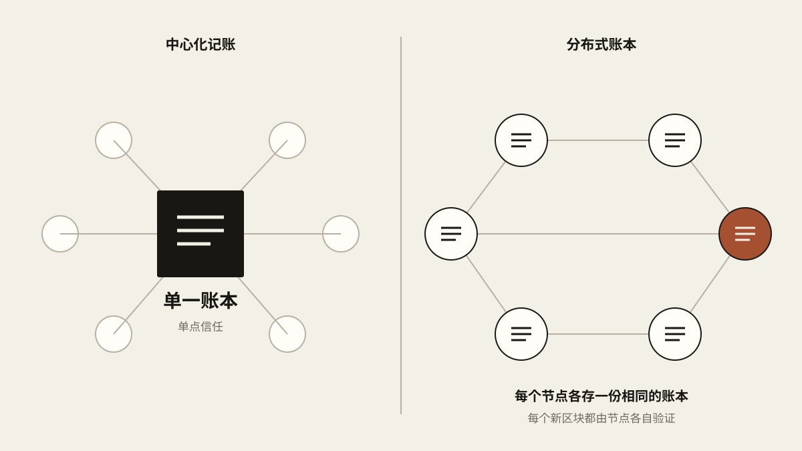
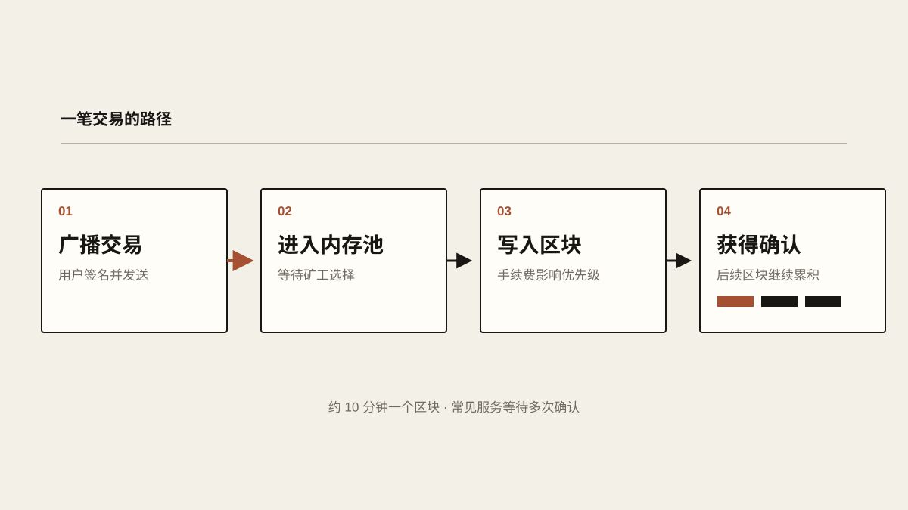
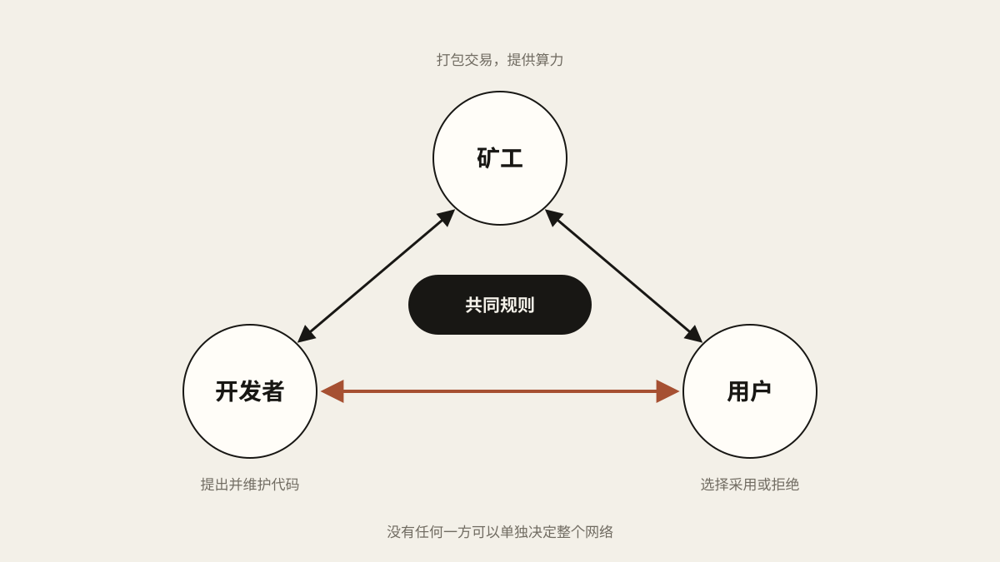

# 什么是比特币？

比特币这东西，好像总带着点神秘感。一枚已经值几万美元，机构和投资者几乎没有不知道它的，可真正弄懂它怎么运作的人并不多。很多人想不通它凭什么这么贵，甚至觉得它生来就是为了诈骗，是个彻头彻尾的庞氏骗局。

我对它有一个自己的比喻：比特币像是一群地位平等的“员工”共同创办的一家乌托邦公司。这家公司只做一样东西，一种独一无二的货币，顺带给了人一种全新的储蓄方式。这篇文章想尽量少用术语，把它讲清楚。哪怕你完全是个新手，读完也能明白比特币到底是个什么东西。

## 一本大家一起记的账

说白了，比特币是一个分布式账本。

传统的账，通常由一个人或者一家机构来记，比如银行、证券公司。账本握在谁手里，你就只能相信谁，信任问题也由此而来：公司可能财务造假，银行可能不兑付存款。2022 年，河南几家村镇银行就出过这样的事：储户的钱取不出来，银行不认账，去讨说法的储户甚至还挨了打。

比特币换了一种做法。这本账不归任何一家机构，而是由全世界成千上万个节点各存一份、一起维护。每一个新区块，这些节点都会各自独立验证一遍，谁交上来的东西不符合规则，就会被大家直接拒绝。没有谁说了算，所以也就不必非得相信某一个人。

<!-- blog-image-agent:start id="bitcoin-ledger-topology" -->
<figure class="article-figure article-figure--agent" data-image-id="bitcoin-ledger-topology">
  
  <figcaption>图：银行只有一本账，大家只能信它；比特币让每个节点各存一份，各自核对。</figcaption>
</figure>
<!-- blog-image-agent:end id="bitcoin-ledger-topology" -->

## 区块、挖矿和确认

比特币的账是一页一页记的，每一页叫一个区块。每个区块都指向前一个区块，首尾相连，就成了大家常听到的区块链。区块里写着一批交易记录，比如“A 转给 B 1 个 BTC”，一个区块通常能装下几千笔。到我写这篇文章的时候（2026 年 8 月 1 日），区块已经快到 100 万个了。

“挖矿”争的，就是下一页由谁来写。矿工用专门的机器反复计算区块数据的哈希值（可以把它理解成一串数字指纹），谁先碰出一个符合难度要求的结果，谁就获得这一页的记账权，拿到新发行的比特币和这一页里的手续费。

这个过程极其耗电，而这正是比特币安全的来源：想篡改账本，攻击者得掌握全网过半的算力，代价高到几乎不可能。网络每隔 2016 个区块，也就是大约两周，会根据全网算力调整一次挖矿难度，让平均出块时间稳定在 10 分钟左右。

一笔转账通常要等 20 到 30 分钟才算到账，因为不少交易所和应用要等三个左右的确认才放心：交易被打包进区块，算第一次确认，之后每多出一个新区块，就再多一次。手续费由用户自己定，矿工会优先打包出价高的交易。

<!-- blog-image-agent:start id="bitcoin-transaction-path" -->
<figure class="article-figure article-figure--agent" data-image-id="bitcoin-transaction-path">
  
  <figcaption>图：交易广播出去，在内存池里排队，被矿工打包进区块，之后每多一个区块就多一次确认。</figcaption>
</figure>
<!-- blog-image-agent:end id="bitcoin-transaction-path" -->

## 谁说了算

除了矿工，比特币网络里还有两类角色：开发者和用户。

开发者维护着比特币的软件。他们在社区里提出改进方案，只有得到广泛认同，改动才会真正进入代码。大多数提议最后都没能落地，这其实是好事：比特币的用户太多了，三天两头改规则，网络就谈不上稳定；而且开发者之间、用户之间都很容易产生分歧，总不能为了一部分人的想法，就把另一部分人撇在一边。

所以真正称得上“大改”的升级，一只手数得过来。2015 年提出、2017 年激活的隔离见证（SegWit），把交易里的签名数据单独拿出来存放，让原本只有 1 MB 的区块装得下更多交易；2021 年的 Taproot，又在隐私和效率上往前走了一步。常被一起提起的闪电网络，其实不是对比特币本身的修改，而是 2018 年上线、搭在比特币之上的第二层网络，专门让小额支付几乎即时完成。

2017 年还发生过一次分家。当时社区为扩容吵得不可开交：一派认为区块太小、交易太慢，干脆分叉出一条新链，也就是比特币现金（Bitcoin Cash，简称 BCH），区块上限一开始就是 8 MB，后来又提到 32 MB；另一派则担心，区块越大，普通人越难自己运行节点，网络就会越来越中心化。

用户是这个生态的终点。买不买、用不用比特币，最终由他们决定。如果算力因为某些原因大幅下降，网络变得不够安全，用户可以拒绝使用，开发者也会想办法改进；如果开发者被大资本左右，改出一套偏向权贵的规则，矿工可以拒绝挖矿，用户可以拒绝升级、拒绝购买，币价随之下跌。币价一跌，攻击网络就更不划算了，没人愿意做这种吃力不讨好的事。

2017 年就有一个现成的例子：一批大公司和矿池签了协议，想在隔离见证之后再把区块扩大一倍，史称 SegWit2x。可用户和节点运营者不买账，到了那年 11 月，这个计划只好取消。

矿工、开发者、用户，三方的权力来源各不相同，彼此牵制，有点像一种微妙的三权分立。任何一方单独垮掉，比特币都不会因此消亡。

<!-- blog-image-agent:start id="bitcoin-governance-balance" -->
<figure class="article-figure article-figure--agent" data-image-id="bitcoin-governance-balance">
  
  <figcaption>图：矿工、开发者和用户手里的权力各不相同，谁也没法单独把规则强加给其他人。</figcaption>
</figure>
<!-- blog-image-agent:end id="bitcoin-governance-balance" -->

## 2100 万枚

更关键的一点是，比特币的总量被代码锁死在 2100 万枚，任何人、任何机构都无权增发。在我看来，这让它非常接近一种理想的货币。

了解一点各国的货币史，就知道这有多珍贵：1948 年国民政府发行的金圆券，不到一年就几乎成了废纸；今天的土耳其里拉；还有最近因为美伊战争汇率崩盘的伊朗里亚尔。历史上像这样一路暴跌的货币，真要一一列出来，一整天也写不完。

## 没人能冻结的钱

只要你自己保管得当，没有任何第三方能冻结你的比特币。

这和一些银行的做法形成了鲜明对比。现代银行只要怀疑你的账户有可疑交易，冻结起来易如反掌。这对保护用户确实有好处，但有时候也会给人带来很多麻烦。

## 关于波动

最后说说比特币的价格波动。它全年无休、全球交易，没有涨跌停，也没有熔断，价格起伏非常剧烈，有时一天之内就能波动 10% 以上。所以想投资比特币的人，一定要控制好仓位，不然对心脏不太友好。

不过我个人并不觉得波动是件多要紧的事。把任何一种资产的价格曲线拉长看，没有哪一个没经历过大起大落：纳斯达克在互联网泡沫破裂后跌了将近八成，标普 500 如果往前追溯到大萧条，跌幅也超过八成。很多投资者嫌比特币风险高，可他们同时也在赌那些“稳定”的资产永远不会出问题。

在我看来，比特币的高波动反而是件好事。它形成了一种天然的反脆弱结构：用连续不断的小损失，避免了未来某一天的大损失。关于“反脆弱”，推荐读一读纳西姆·塔勒布的《反脆弱》，这对投资者来说绝对是一本很重要的书。
