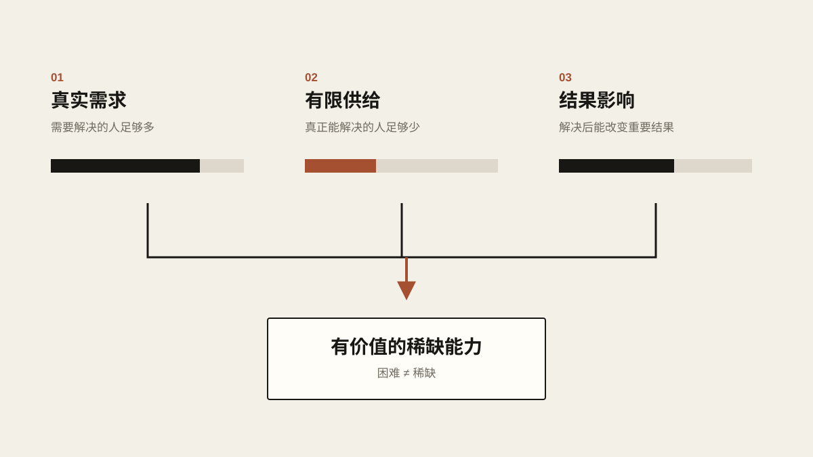
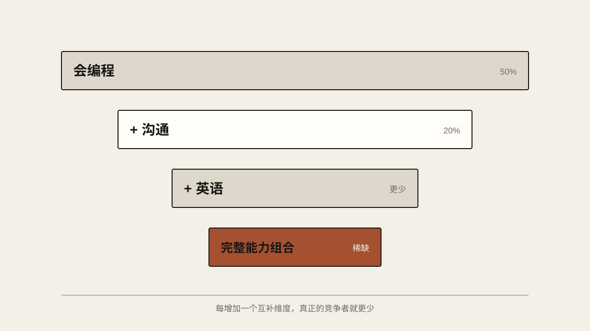

# 什么是稀缺的技能

最近找工作，我越来越强烈地意识到一件事：这个社会上，会做事的人其实已经太多了。

打开招聘软件，随便点开一个稍微像样的岗位，几百个人投简历早就不稀奇了。一个刚毕业的大学生，会用 Office，会剪视频，会做 PPT，会一点 Python 和 Java，四六级都过了，还能用 ChatGPT 帮自己写代码。把时间往前推十几年，这样的人大概算得上能力不错；放到今天，只是一个再普通不过的毕业生。

不是大家变差了。恰恰相反，是大家会的东西太多，而且都差不多。

这听起来有点反常识。按照学校教我们的逻辑，人应该不断学技能，会得越多，竞争力越强。可市场显然不是这么运转的。它不会因为一样东西很难学，或者你为它熬了多少个通宵，就多给你一分钱。它关心的问题简单得近乎冷酷：我为什么非得找你？

假设一个岗位收到 1000 份简历，其中 700 个人会 Java。“会 Java”当然是一项技能，但已经很难算是优势了。再假设剩下 300 个人除了 Java 还会 Python，Python 也不会神奇地让他们变值钱，因为他们真正的竞争对手，是另外 299 个和自己差不多的人。

很多人找不到工作，第一反应还是继续往身上叠技能：Java 不够就学 Python，Python 不够就学 Go，然后是 Docker、Kubernetes、Redis、微服务。简历越来越长，人却没有明显变贵。

这和投资其实很像。一样东西值多少钱，从来不取决于生产它花了多少力气，而取决于有多少人想要、有多少人能提供。钻石贵，不只是因为挖它的人辛苦；路边的石头再沉，也没人愿意花钱买。技能说到底也是一种商品。想明白这一点，很多看起来奇怪的现象就不奇怪了。

摄影以前是一门专业手艺：要懂曝光、快门、ISO、镜头和构图，还得买一堆昂贵的器材。现在一个完全不懂摄影的人拿起手机，就能拍出二十年前普通爱好者很难拍出来的照片。剪辑也一样。以前想剪个像样的视频，得学 Premiere、Final Cut，研究时间轴、转场和调色；后来有了剪映；再后来，AI 能自动识别字幕、删掉停顿、配好音乐，甚至直接拿一段文字生成视频。

编程正在经历同样的事情。

我本科就是计算机专业，所以对这一点的感受格外明显。几年前，一个人能从数据库、后端一路写到前端，做出一个完整的网站，至少还算一项明确的技术能力。现在让 AI 写一个网站，已经没什么值得炫耀的了。你甚至不需要真的懂 React 或者 Vue，只要大概知道自己想做什么，再和 AI 聊上几个小时，一个能跑起来的东西多半就出来了。

这不代表程序员会消失，也不代表编程没有价值。真正在发生的是，“会写代码”这几个字本身在贬值，而这两者差别很大。工业革命没有让制造业消失，只是让大量纯手工劳动的价值下降了；Excel 没有消灭财务，只是让很多手工计算失去了过去的溢价。AI 也不会把脑力劳动一扫而空，它最先压缩的，多半是那些已经高度标准化、能被说清楚、能被重复执行的脑力劳动的溢价。

一项技能只要能被清楚地描述、被系统地教授、被量化地验收，最后就很容易被批量生产。而大学最擅长的恰好就是这件事：编一本教材，定一份大纲，设计一套考试，然后每年生产出几十万个掌握相似知识的人。所以现在看到“某某专业非常热门”“某某技能未来缺口几百万”这样的新闻，我的第一反应已经不是赶紧去学，而是想另一个问题：如果所有人都知道它缺人，五年以后它还缺人吗？

公开的红利通常活不了太久。互联网工资高的那几年，大批的人去学计算机；自媒体赚钱的时候，大批的人开始拍短视频；人工智能火了以后，现在几乎人人都想学 AI。这再正常不过：价格本身就会吸引供给。一样东西越赚钱，涌进来的人越多，原本的稀缺也就消失得越快。

## 难，不等于稀缺

所以我觉得，真正值得学的不是“难的技能”，而是“稀缺的技能”。这两个概念经常被混为一谈。高等数学很难，但学好了高数，不代表就一定有人给你开高薪。世界上还有大量冷门又复杂的知识，可能只有几百个人懂，可要是没人需要，它照样没什么经济价值。

稀缺，必须和需求同时存在。

有一万个人急着解决一个问题，而只有一百个人会解决，这才是有价值的稀缺。所以现在判断一项技能值不值得学，我更愿意看三件事：有多少人需要它，有多少人能提供它，以及掌握它以后，到底能影响多大的结果。

<!-- blog-image-agent:start id="scarcity-demand-supply-impact" -->
<figure class="article-figure article-figure--agent" data-image-id="scarcity-demand-supply-impact">
  
  <figcaption>图：难学不等于值钱。很多人需要、很少人能做、做了能改变重要的结果，三者缺一不可。</figcaption>
</figure>
<!-- blog-image-agent:end id="scarcity-demand-supply-impact" -->

顺着这个逻辑想下去，我反而觉得，未来最稀缺的东西，可能根本不是哪一款软件，也不是哪一门编程语言。

## 发现问题的能力

AI 非常擅长回答问题，前提是你知道该问什么。

比如一家公司说：“我们要用 AI 降本增效。”这句话听起来无比正确，实际上几乎什么都没说。普通人可能马上开始研究大模型、Agent、RAG，然后做一份几十页的 PPT，告诉老板人工智能有多厉害。真正有价值的人，却可能先跑去看公司的业务流程：客服到底花了多少钱？哪个环节最浪费人力？错误率最高的地方在哪里？这个问题真的需要 AI，还是写一个五十行的脚本就能解决？甚至，公司真正的问题会不会根本不是效率，而是产品压根没人买？

能回答问题的人很多，能发现真正问题的人少得多。当 AI 让“答案”越来越便宜，“问题”自然就变贵了。

## 判断力

现在互联网上最不缺的就是信息。想买一只股票，AI 一分钟就能给你生成一份几千字的分析报告；想找工作，它可以帮你分析十家公司；想创业，它能一口气列出一百种商业模式。

然后呢？这项资产到底值不值得买，这份工作到底该不该去，这门生意到底有没有人愿意付钱？AI 可以给你二十个支持的理由，转头又能给你二十个反对的理由，可最后那个按钮，还是得有人来按。

信息越便宜，判断反而越重要。过去信息本身就是门槛，有些人赚钱，只是因为他们知道别人不知道的事。这种优势正在飞快地消失。以后真正拉开差距的，可能不再是你能不能找到信息，而是当所有人手里的信息都差不多时，你能不能得出一个比别人更好的结论。

判断力这东西很讨厌，因为世上没有一门“判断力 101”，让你学完就能拿证。它更多来自长年累月的经验、失败和反馈，也取决于一个人愿不愿意一次次承认自己以前错了。很多能力靠重复练习就能很快进步，判断力却往往要等真实世界一次又一次把错误拍在你脸上，才慢慢长出来。

## 承担责任

还有一样东西，严格来说都算不上传统意义上的技能：承担责任。

我以前一直觉得，社会给某些管理者那么高的工资有点奇怪。有些经理看起来什么具体的活都不干：代码不是他们写的，PPT 不是他们做的，数据也不是他们统计的，凭什么比下面的人赚得多？后来我慢慢明白，真正值钱的部分往往不是“做”，而是“定”。

程序员可以提出三套技术方案，CTO 必须选一套；分析师可以写几十页报告，基金经理必须决定买还是不买；十个人可以在会议室里讨论一个项目，但最后总得有一个人站出来说：“就这么干，出了问题我负责。”执行、分析、判断、决策、承担后果，这条链越往后，人通常越少。大多数人都喜欢权力，可真正喜欢责任的人很少。

做对了，大家都开心；做错了，可能挨骂、被开除、亏钱，严重的还要承担法律责任。所以责任本身就是一种稀缺资源。AI 可以替你生成方案，帮你列出几十种可能，但它不会替你坐牢，也不会替公司扛下一千万的损失。最后，总得有一个真实的人把自己的名字签上去。

## 技能的组合

还有一种我觉得经常被低估的稀缺：技能之间的组合。

单看每一样，可能都不稀缺。会英语的人很多，会写代码的人很多，懂销售的人很多，懂新能源的人也不是什么珍稀动物。可如果一个人既懂软件，又能用英语和海外客户沟通，还了解一些新能源设备，能在现场把客户的问题真正解决掉，符合条件的人一下子就少了很多。这样的组合带来的优势，可能比把 Java 从“熟练”刷到“精通”有意义得多。

很多人一直在同一条轴上和别人竞争：程序员比谁刷的算法题多，设计师比谁的软件用得熟，剪辑师比谁的特效做得复杂。问题是，只要所有人都挤在同一条轴上，迟早会卷成价格战。看看现在的 IT 就业市场就知道了：只要院校和履历不是特别有竞争力，很多学生连一份像样的实习都很难找到。大量的人拿着高度重复的项目，投着高度相似的简历，HR 每天看下来，可能早就麻木了。

有时候最简单的办法，是别在原来那条轴上卷了，换一条。一个普通程序员，加上销售能力，可能变成很强的 SaaS 销售或者售前；一个普通工程师，加上英语和海外经验，可能变成海外技术支持；一个懂 AI 的人，如果还真正理解医疗、法律、物流或者制造业里的某个具体流程，这个人的价值可能远远高过另一个只会研究 Prompt 的人。

单项能力根本不需要做到世界第一，只要几样能力恰好互补，组合起来就可能落进一个人数少得多的区域。假设 50% 的人会编程，40% 的人擅长沟通，如果这两项能力大致独立，同时具备两者的人大概只剩 20%；再叠上英语、行业知识和项目经验，真正同时满足所有条件的人会更少。现实当然不像数学模型那样完全独立，但这个思路很重要：你不一定非要在一个维度上打败所有人，也可以多加几个维度，让真正和你竞争的人越来越少。

<!-- blog-image-agent:start id="scarcity-skill-stack" -->
<figure class="article-figure article-figure--agent" data-image-id="scarcity-skill-stack">
  
  <figcaption>图：不必在一条轴上打败所有人，每多一项互补的能力，真正的竞争者就少一圈。</figcaption>
</figure>
<!-- blog-image-agent:end id="scarcity-skill-stack" -->

## 和人打交道

还有和人打交道的能力。这东西听起来很“虚”，甚至不像一门技术，但我越来越觉得，它可能是 AI 时代最难贬值的能力之一：谈判、销售、建立信任、协调利益、说服别人、处理冲突。这些事情的核心都不是简单的信息交换，如果只是交换信息，发封邮件就够了。

一个客户为什么愿意把一百万的合同交给你，而不是另一家技术参数差不多的公司？一个优秀的人为什么愿意加入你的团队？两家公司利益冲突的时候，为什么愿意各退一步？

就连最普通的一场面试，考的其实也是和人打交道的能力。一个人技术很强，却完全讲不清自己的想法，甚至一开口就结巴，面试官就很难相信这个人能合作、能沟通、能解决问题，那些技术能力也就很难完整地变成竞争力。反过来，技术未必最强，但表达清楚、反应快、听得懂需求、让人信得过的人，往往更容易让别人愿意给一次机会。

背后都是信任和博弈。

AI 当然可以教你怎么说话，甚至能替你生成一套完美的谈判话术。但对方最后信任的是一个人，不是一段生成出来的文字。

## 把事情真的做完

最后一种我认为非常稀缺的能力，说出来甚至有点好笑：把事情真的做完。

网上聪明人太多了。谈宏观经济的人很多，真正长期赚到钱的人很少；讨论创业的人很多，真正把产品发布出去的人很少；研究 AI 的人很多，真正做出一个有人愿意一直用下去的产品的人，也很少。每天收藏几十篇“必看教程”“深度好文”“行业趋势”，最后收藏夹比自己的实际成果丰富得多。这种事几乎人人都干过，我自己也经常掉进这个坑。

研究一样东西，会让人产生一种很舒服的错觉，好像自己已经在行动了，其实很多时候只是在消费信息。真正难的事往往无聊透顶：把第一版做出来，发给别人，挨骂，改掉问题，再发一次；投几十份简历，被拒，再改；学了英语以后，真的张嘴和人说，而不是继续收藏口语教程。

这个世界从来不缺知道该怎么做的人。缺的是在没有老师盯着、没有标准答案、甚至不知道最后有没有回报的情况下，还能自己把事情一点一点往前推的人。我不知道这种能力最准确的中文名字是什么，英文里有个词我很喜欢，叫 Agency。你可以把它理解成主动性，也可以理解成一个人主动改变现实的能力。

我反而觉得，这是未来最不容易被 AI 替代的东西之一。AI 可以把做成一件事的门槛降下来，但门槛低了，不代表所有人都会真的去做。健身的方法在网上早就免费了，大部分人照样没练出理想的身材；英语学习资料比几十年前丰富了不知道多少倍，真正能流利使用第二语言的人还是少数；创业教程几乎无限供应，大部分人一辈子也不会卖出自己的第一件产品。

信息不是最大的瓶颈。

很多时候，人自己才是。

## 别再问“该学什么”

所以如果现在让我重新理解“学技能”这件事，我不会再只问什么技能最热门。热门本身，甚至可能是一个危险信号。一样东西一旦热到所有短视频博主都在教、所有培训机构都在卖课、所有大学都准备开专业，它的供给通常已经在路上了。

更值得观察的是另外几个问题：未来几年，什么问题会越来越严重？什么东西，很多人愿意花钱去解决？为什么现在解决它的人还这么少？门槛到底在哪里？是知识，是经验，是资本，是牌照，是语言，是地理位置，是承担风险的意愿，还是大家单纯嫌它麻烦、不体面、不想干？

我尤其喜欢最后一种。

人类有一个非常稳定的特点：喜欢追逐那些看起来光鲜的机会。大家都想当投资人、产品经理、AI 工程师、创业者。没人喜欢处理客户投诉，没人喜欢凌晨爬起来修机器，没人喜欢跑到陌生国家的工厂里排查设备故障，也没人喜欢处理一堆又脏又琐碎、在社交媒体上毫无炫耀价值的问题。

可市场并不在乎一件事听起来酷不酷。

别人不愿意干，客户又真的需要，有时候这就是最直接的稀缺。

当然，稀缺也不会永远存在，这恰恰是最麻烦的地方。一项技能一旦足够赚钱，聪明人就会涌进来，培训机构会出现，教程会出现，软件会出现，最后 AI 可能也会进来。昨天的稀缺，很可能就是明天的标配。

所以想找到一门技能，然后靠它舒舒服服吃上四十年，我觉得越来越不现实了。真正长期有效的，可能是一种不断发现稀缺的能力：在别人还没注意到的时候，看见一个正在增长的需求；在人群大规模涌进来之前，先在里面做上几年，攒下经验、客户、资本、人脉和信誉；等这个领域慢慢挤满了人，再去找下一条曲线。

某种意义上，这和套利没什么两样。金融市场里，一个套利机会被所有人发现以后，空间很快就会被抹平。劳动力市场也是一样：如果所有人都知道某项技能工资高，它迟早就不再那么稀缺。

所以我越来越不喜欢问别人：“未来我该学什么？”

这个问题本身可能就问错了。

没有人能列一张清单，告诉你 Python 值 10 分、英语值 8 分、AI 值 9 分，照着学完，人生就安全了。真正该问的是：未来五年，哪些问题会越来越重要？这些问题为什么难解决？现在是谁在解决，他们为什么这么贵？最重要的是，为什么其他人没有去做？

找到这些问题，然后让自己成为少数能解决它们的人。

这大概才是所谓的稀缺技能。
