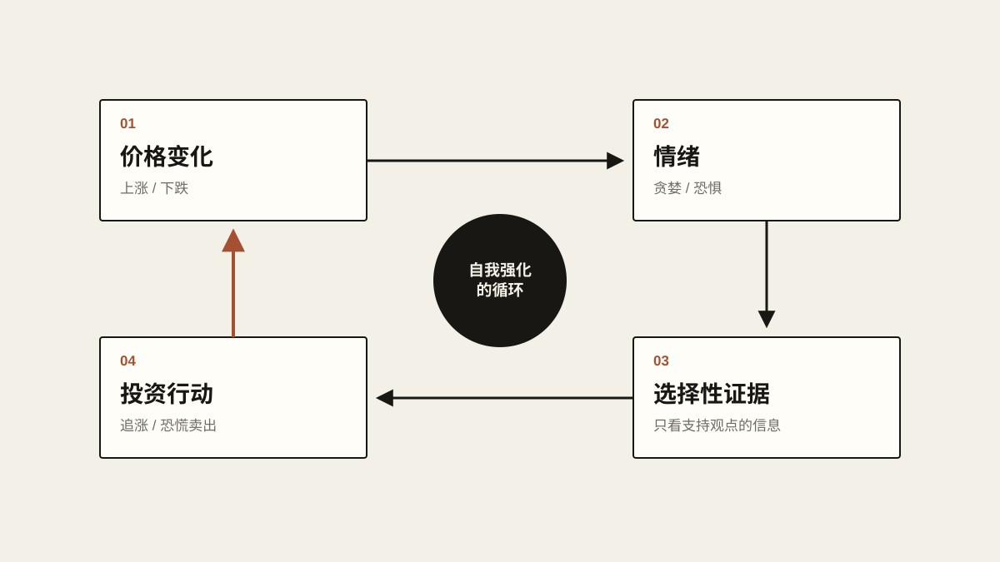

# 关于投资的心理学

超市里一件东西从一百块降到七十块，大多数人会觉得捡了便宜。东西还是那个东西，价格低了，自然更想买。

金融市场常常反着来。一项资产从一百涨到一百五，开始有人觉得它值得买；涨到两百，讨论它的人多了起来；涨到三百，连原本毫无兴趣的人也开始研究。等到身边所有人都在赚钱，很多人才终于说服自己：“这东西确实不错。”

跌的时候，剧情倒着再放一遍。一百块时觉得它很好，九十块开始犯嘀咕，七十块回过头去重新研究风险，跌到五十，突然发现它浑身都是毛病，最后在最悲观的那一天把它卖掉。

如果资产本身什么都没变，这件事其实相当荒唐：东西变贵了，人反而越来越喜欢；东西变便宜了，人却越来越讨厌。投资大概是少数几个越涨价越有人抢着买的市场。也正因为这样，我越来越觉得，投资真正难的部分从来不是分析资产，而是分析自己。

## 跌下来以后，人会换一个脑子

很多人在开始投资以前，都相信自己很理性。研究财报，研究行业，研究宏观经济，算好估值，定好买入价，还会认认真真地告诉自己：“就算跌了，我也绝对不慌。”

这种话在市场平静的时候最好说。真跌下来，是另一回事。账户里的十万变成八万，脑子里很多东西会悄悄变形：原来叫“短期波动”的东西，现在叫“风险”；以前懒得点开的负面新闻，变得格外刺眼；之前觉得无关紧要的小问题，一夜之间全成了大问题。你开始一遍遍地搜悲观的观点，直到某一天终于忍不住，卖了。

卖完的那一刻，人通常会长出一口气。这口气很能说明问题：很多卖出解决的根本不是投资风险，而是心里的疼。

人对亏损极其敏感。赚一万块的快乐，往往抵不过亏一万块的难受。一笔投资从十万涨到十二万，又跌回十万，账面上一分钱没少，可你的感受很难是“什么都没发生”，更像是“我亏了两万”。因为在某个瞬间，那十二万已经被你默认成了自己的钱。

没卖出去的浮盈，在心里会提前变成私人财产。所以价格从十二万跌到十一万的时候，大脑不会说“我还赚着一万”，它只会说“我刚刚丢了一万”。价格再往下走，这种疼会一层一层叠上去。到最后，很多决定已经和未来的收益没什么关系，只围绕一个更朴素的问题：怎么做，才能让自己好受一点？

## 贪婪从来不自我介绍

涨的时候也一样。一项资产刚开始涨，人还挺谨慎；涨得越多，谨慎反而越少。原来觉得年化百分之十已经很好的人，连涨几轮以后，会觉得百分之二十才算正常。原本打算赚三成就走的人，真赚到三成，又开始惦记五成；到了五成，又想：凭什么不能翻倍？终点线一直在往后挪，这就是贪婪最麻烦的地方。

贪婪不会突然冒出来，很诚实地跟你打声招呼：“我来了。”它总是穿着一身很讲道理的衣服：“基本面变好了。”“空间比原来想象的大。”“这次不一样。”“趋势这么强，卖了可能就再也买不回来了。”这些话单拎出来，每一句都可能有道理。真正危险的是，你很难分清自己是在重新评估事实，还是只因为价格涨了，人跟着乐观了起来。

价格不光会改变你的财富，还会改变你解读现实的方式。涨的时候，利好消息听起来格外可信：公司出了新产品，那是巨大的增长空间；行业来了新政策，那是长期趋势被确认；机构在买，那是聪明钱认可；竞争对手退出，那是格局变好了。同一项资产一旦开始跌，同样几件事会被重新讲一遍：新产品可能失败，政策充满变数，机构也许只是短炒，竞争只会越来越激烈。

很多时候，事实一点都没变，变的只是价格。价格改变情绪，情绪筛选信息，筛出来的信息又反过来证明情绪是对的。这个循环转起来的时候，身在其中的人几乎察觉不到。

<!-- blog-image-agent:start id="investment-feedback-loop" -->
<figure class="article-figure article-figure--agent" data-image-id="investment-feedback-loop">
  
  <figcaption>图：价格一动，情绪跟着动；情绪挑选证据，下一笔交易又把价格推了出去。</figcaption>
</figure>
<!-- blog-image-agent:end id="investment-feedback-loop" -->

我们总以为自己是先看到证据，再形成观点。现实里常常反过来：观点先到，然后才去找证据。涨的时候，持有的人会主动搜集一切看涨的理由；跌的时候，同一个人又会去搜集一切该卖的理由。互联网让这件事变本加厉，因为不管你想证明什么，都能找到足够多的材料。觉得要涨，几十篇看多的研报等着你；觉得要崩，也有几十篇逻辑严密的悲观分析。信息已经多到不可能自己变成答案。一个人在市场里看到的，往往只是现实中自己愿意看到的那一部分。

## 市场不知道你的成本价

还有一样东西很有意思：成本价。

人对自己的买入价有一种近乎执念的感情。一百块买进，跌到八十，最常冒出来的念头就是：“等它涨回一百我就卖。”这句话听着再自然不过，细想却没什么道理。市场不知道你是一百块买的，公司管理层不知道，别的交易者也不知道，公司未来的现金流更不会因为你的成本价多一分或少一分。

如果它现在只值五十，从八十涨回一百，并不会因为你曾经在一百块买过就变得更合理；如果它其实值两百，那么为了“回本”在一百块卖掉，同样说不通。成本价本来只是一条历史记录，到了人脑里，却很快变成一个锚，盈亏都围绕这个锚被重新定义。一项八十块的资产本身无所谓红绿，可交易软件只要在旁边标上一个“-20%”，你的感受立刻就不一样了。

很多时候，我们判断的并不是一样东西值多少钱，而是它离“我的价格”还有多远。

## 别人赚钱的时候

牛市里还有一股很强的力量：看别人赚钱。

自己亏钱当然难受，但看着别人赚钱、自己没赚到，有时候一样难受。你本来压根没打算碰某样东西。一个朋友赚了三成，你没当回事；又一个朋友赚了五成；社交媒体开始讨论，新闻开始报道，晒收益的人越来越多。某一天你会开始怀疑，自己是不是错过了什么。价格涨得越高，这种感觉往往越强烈。到最后，推着人下单的早就不是预期回报了，是怕自己被永远落在车外。

今年上半年的存储牛市，就让我结结实实地 FOMO 了一回。那段时间不管刷抖音还是刷推特，随手划几个帖子和视频，就能看到一堆人在晒单，闪迪、海力士、美光这些股票，有人甚至已经赚了好几倍。可我当时觉得自己并不懂这个行业，所以终究没有买。

这也解释了为什么很多人在一样东西无人问津的时候毫无兴趣，等它涨了好几倍，才突然生出巨大的研究热情：上涨本身就会制造可信度。

人是很依赖群体判断的动物。在生活里，这套机制大多数时候挺好用：餐厅门口排着长队，通常说明不会太难吃；一件商品有十万条好评，通常比一条评价都没有的靠谱。金融市场的麻烦在于，当所有人都因为“别人在买”而买，他们的买入本身又会继续推高价格。于是上涨证明上涨，越来越多的人加入，最后价格本身成了最大的理由。

跌的时候也是同一套逻辑：大家都在卖，所以跌；一跌，又像是证明了风险很大，于是更多人卖。人群可以制造狂热，也可以制造恐慌。而站在人群里的人，几乎从来不觉得自己在从众，只觉得自己做了一个独立的判断。

## 最舒服的时候，往往最贵

人还特别喜欢相信，最近发生的事会一直发生下去。一个市场连涨几年，大家就把上涨当成常态；连跌一年，又觉得苦日子永远不会结束。

这种事在历史上重演过无数次。价格最好的时候，新闻往往也最好看：企业利润增长，经济繁荣，人人信心十足，谁都找得到继续乐观的理由。价格最差的时候，情况往往也真的很糟：经济衰退，公司裁员，坏消息一个接一个，谁都找得到继续悲观的理由。

所以投资才这么反直觉。真正便宜的资产很少让人觉得“安全”，因为如果所有问题都已经解决、所有人都信心满满，它大概也就不会再便宜了。反过来，真正贵的时候往往最舒服：账户天天在涨，新闻全是好消息，身边人人都在赚钱，未来看上去一片光明。风险很少穿着一件印着“风险”两个字的衣服出场，更多时候，它看起来像确定性。

赚了钱以后，人还很容易高估自己。第一次进场就连着买对三次的人，很难得出“我可能只是运气好”的结论，更常见的想法是“我好像真挺擅长这个”。于是一万块变成了五万块，简单的资产换成了复杂的东西，原来碰都不碰的杠杆，也开始觉得“稍微加一点应该没事”。

赚钱带来的不只是钱，还有自信，而自信又会让人愿意承担更大的风险。所以投资里有一种开局特别危险：一上来就赚了很多。亏损至少会逼人怀疑自己的方法；连续盈利却可能让一个从没经历过完整周期的人，迅速相信自己掌握了某种规律。等真正的大波动到来时，这个人身上背着的风险，可能早已远远超过刚入场的时候。

## 一厘米和一百米

所以光谈“心理素质”是不够的。一个人的投资心理，很大程度上是由仓位决定的。

一万块的资产跌百分之三十，和一个人的全部积蓄跌百分之三十，是两场完全不同的心理实验。前者可能让你觉得“更便宜了”，后者可能让你凌晨三点还在刷新行情。

理论上，同一个人面对同一项资产，应该做出同样的判断。实际上，仓位一变，人可能就换成了另一个人。市场每跌一点，生活里的某个目标就离你远一点：买房的首付，孩子的学费，攒了好几年的积蓄，养老的钱。一旦这些具体的东西和屏幕上的数字连在一起，再冷静的人也很难把它当成一道单纯的数学题。

很多所谓的投资心理问题，归根结底是风险管理问题。如果一次再正常不过的波动，就足以让一个人推翻原来的全部逻辑，那未必是意志力太差，更可能是仓位从一开始就太重了。道理很简单：站在离地一厘米的木板上，谁都能稳稳当当；把同一块木板架到一百米高的两栋楼之间，身体马上就僵了。平衡能力并没有突然消失，变的是犯错的代价。

<!-- blog-image-agent:start id="investment-high-wire" -->
<figure class="article-figure article-figure--agent" data-image-id="investment-high-wire">
  
  <figcaption>图：同一块木板，同样的平衡感，变的只是失足的代价。仓位也是这样改变判断的。</figcaption>
</figure>
<!-- blog-image-agent:end id="investment-high-wire" -->

投资也是这样。很多人模拟盘做得异常理性，真金白银一进去，马上换了个人。这并不奇怪，真的钱会带来真的情绪。

## 写给未来那个自己的合同

也正因为如此，我一直觉得“保持理性”几乎是一句没用的投资建议。没有人是因为不知道应该理性，才变得不理性的。暴跌时恐惧，不需要谁来教；连涨时贪婪，也不需要学。

这些反应在现代金融市场出现以前就已经存在了。恐惧帮祖先躲开危险，跟着群体走能提高活下来的概率，损失厌恶让人珍惜手里已有的资源；在野外，根据最近发生的事迅速调整判断，可能比慢慢建立一个概率模型有用得多。问题只是，我们带着一颗为生存而设计的大脑，走进了一个由数字、概率和长期复利构成的市场。曾经帮人类活下来的本能，到了这里，恰好可能变成弱点。

所以真正有用的办法，大概不是把自己训练成一个没有情绪的人，这样的人基本不存在。更现实的做法，是承认自己一定会有情绪，然后提前定好规则，让情绪没那么大的权力。

买之前，先回答几个问题：为什么买？到底看中了它什么？出现什么情况，就说明我原来的判断错了？我最多愿意承受多大的亏损？这笔仓位要是跌掉一半，会不会影响正常生活？如果价格涨了很多，是价值真的变了，还是只是价格变了？如果价格跌了很多，而当初的逻辑还在，我到底该做什么？

这些问题在买之前很好回答，因为那时候钱还没开始左右你的情绪。真拿在手里以后再回答，就难多了。人会开始偷偷修改答案，而且通常不会承认自己在改。

投资计划最大的用处可能就在这里。它不是用来预测未来的，没有人知道未来。它更像一份合同，是过去那个冷静的你，写给未来那个情绪化的你。市场涨上去，未来的你可能会觉得一切都还能接着涨；市场跌下来，未来的你又会觉得世界马上就要完了。如果每一次都让当下的情绪重新制定规则，那所谓的投资策略其实根本不存在，剩下的只有条件反射。

当然，这不是说一个人永远不能改变看法。死不认错不叫纪律。新的事实证明原来判断错了，改主意当然是对的。真正难的是分清楚：到底是事实变了，还是价格变了？是投资逻辑失效了，还是自己亏了钱、心里难受了？是这项资产真的越来越值钱，还是因为赚了钱，所以想相信它越来越值钱？

这可能是投资里最难回答的问题之一，因为你既是法官，又是被告。你得判断自己的判断有没有被情绪带偏，而做这个判断的，还是同一颗大脑。

所以我不太相信，学会“损失厌恶”“确认偏误”“锚定效应”这几个名词，就能真的克服它们。知道自己有偏见，不等于偏见会消失。谁都知道熬夜不好，照样熬；知道甜食吃多了不好，看到蛋糕还是想吃。人天生趋利避害，容易沉迷在让自己舒服的事情里，投资也不例外。

理论这种东西，收盘以后最好懂。真正的考试，发生在账户每天都在缩水的时候，或者发生在所有人都告诉你“这次真的不一样”的时候。

投资到最后，可能是一个人和自己的比赛。市场只负责不停地报价，恐惧、贪婪、后悔、希望、嫉妒和自信，全是人自己生产的。涨的时候，有一个越来越贪的你；跌的时候，有一个越来越怕的你；连着赚了几次钱以后，还有一个开始觉得自己比谁都聪明的你。这几个人住在同一个身体里，却各有一套完全不同的投资逻辑。

和你交易的，从来不只是市场上的其他人，还有未来的你自己。

一套好的投资体系，未必要准确预测下一次涨跌。它更要紧的任务，是趁那个完全不同的你还没出现，先把规矩立好，让那个你到时候说了不算。

因为市场最擅长的，从来不是直接让人亏钱。它会先改变你的情绪，再让你亲手做出那个亏钱的决定。
