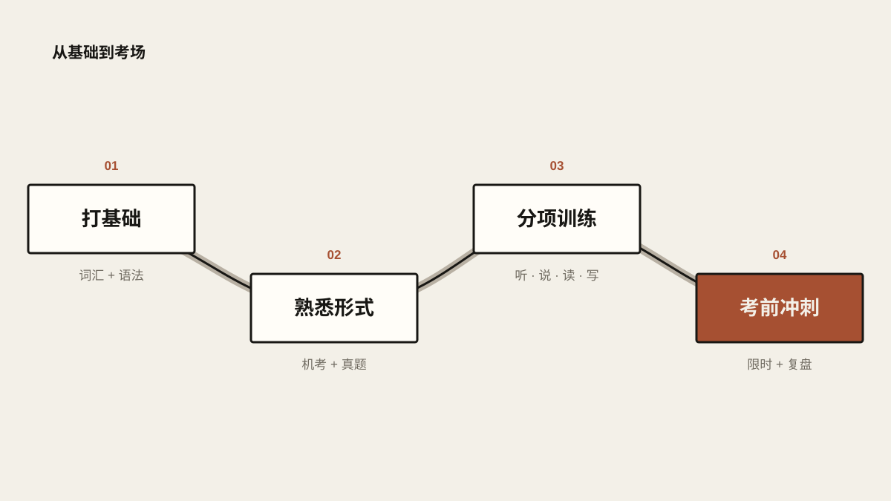
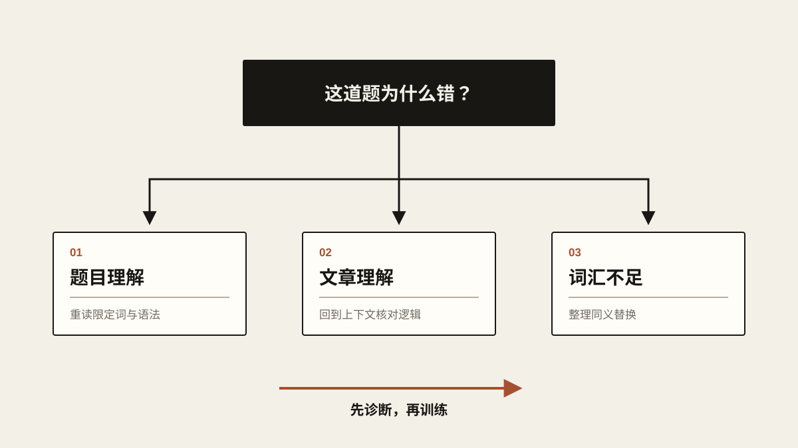
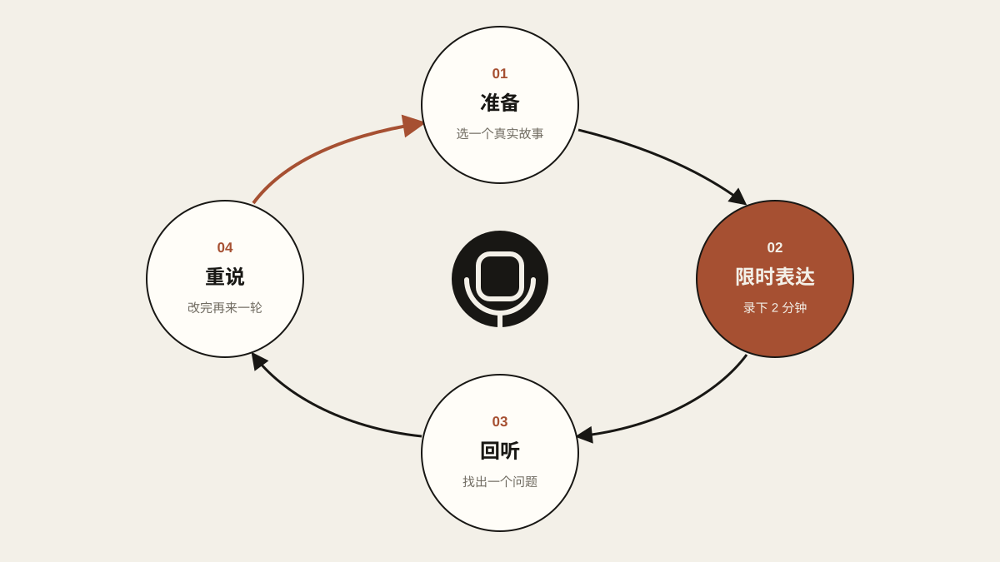

# 平民雅思备考指南：0 成本学雅思教程

> 我自学雅思，首考 7.0，一分钱没花。这篇把我用过的方法、资源和分数参考都整理在这里。观点只代表我个人，不是官方标准；文中的网站现在还能不能用、机经题库新不新，我也没有再去逐一核实。

## 先说工具

- **机考模拟**：ieltscat.xdf.cn
- **作文批改**：essay.art（免费），ielts9.me（付费）
- **官方题以外的练习**：虾滑听力、ZYZ 阅读

虾滑和 ZYZ 属于“机经”，是考过的人凭记忆整理出来的考场原题，有一定概率在考场上碰到。剑桥雅思（剑雅）是官方每年出的真题集，里面的题不会在考场上再出现。即便如此，我还是建议先把剑雅做完，再去刷机经。

## 整体路线

1. **打基础**：词汇 + 语法。
2. **熟悉机考和备考资料**：选好模拟网站和剑桥雅思真题。
3. **分项练习**：听力、阅读、写作、口语。
4. **考前冲刺**：严格限时，复盘错因，过口语题库。

<!-- blog-image-agent:start id="ielts-study-roadmap" -->
<figure class="article-figure article-figure--agent" data-image-id="ielts-study-roadmap">
  
  <figcaption>图：先打基础，再熟悉考试形式，然后分项练习，最后严格限时冲刺。</figcaption>
</figure>
<!-- blog-image-agent:end id="ielts-study-roadmap" -->

基础这一步最不能省。底子打牢了再进入正式备考，效率会高很多。按自己的水平，给基础期留出 **2～6 个月**。

还有一句话请先记住：**雅思考的核心，就是同义替换。**

## 基础：词汇和语法

### 词汇

词汇量的最低参考标准：

| 目标分数 | 参考词汇量 |
| --- | ---: |
| 6.0 | 7,000+ |
| 6.5 | 7,500+ |
| 7.0 | 8,000+ |

我的建议：

- 每天背多少，量力而行。我每天复习 300 个左右，最后词汇量到了 9,000 多。
- 背单词的 App 用主流的就行，比如扇贝单词、不背单词。
- 想知道自己的词汇量，可以用“每日英语听力”测一下。
- 每天打卡，一直坚持到考前一周。

### 语法

建议按这个顺序搭起来：

1. 五种简单句。
2. 连词：把简单句连成长句。
3. 从句。
4. 最后再看虚拟语气这类相对次要的语法点。

学语法不是为了背规则，而是为了练出一种能力：看到一个长难句，能很快抓住它的主干。

有个自测办法：让 AI 生成一些长句，自己先把主干标出来，再让 AI 检查、批改。

免费课程推荐 B 站 UP 主“Larry 想做技术大佬”的《半个月搭建你的语法体系》。

## 机考练习

### 新东方雅思机考网站

- 网址：[ieltscat.xdf.cn](https://ieltscat.xdf.cn/)
- 可以练听力、阅读和写作的模拟考。
- 用来熟悉机考界面和完整的考试流程，很合适。

## 听力

### 日常训练

- 在听力 App 里找难度合适的材料，我推荐 **CNN 10**。
- 做完剑雅的听力题，可以再精听一遍：听一句，写一句。说实话这个方法我自己没试过，但听说大家都是这么练的。
- 多练，练出对语法的快速反应。很多时候听不懂，不只是因为语速快，而是句子的意思没能及时反应过来。

### 6 分和 7 分差在哪

- 听力 6 分：更多靠抓关键词。
- 听力 7 分：能听懂整段话在说什么。

### 真题怎么用

- 建议从《剑桥雅思 10》及之后的真题开始。
- 更早的《剑桥雅思 4～7》可以当补充练习。有些题目和现在的考试差别比较大，做得不好不用太在意。

## 阅读

### 真题怎么用

- 同样建议从《剑桥雅思 10》及之后开始。
- 时间充裕的话，更早的几本也可以做。

### 错题通常错在三个地方

1. **题目没读懂**：漏看了词，或者语法不扎实，把题意理解错了。
2. **文章没读懂**：段落信息没看全；或者明明定位到了答案句，却没读懂它的意思。
3. **词汇不够**：没认出题目和原文之间的同义替换。

<!-- blog-image-agent:start id="ielts-reading-diagnosis" -->
<figure class="article-figure article-figure--agent" data-image-id="ielts-reading-diagnosis">
  
  <figcaption>图：重做之前，先弄清楚错在哪：题目、文章，还是词汇。</figcaption>
</figure>
<!-- blog-image-agent:end id="ielts-reading-diagnosis" -->

## 听力和阅读的共同点

- 先打牢词汇和语法，再学做题技巧。
- 网课推荐 B 站 UP 主“天狗吃月亮”，重点学怎么划关键词、怎么识别同义替换。
- 阅读刚开始可以不限时。不限时的情况下正确率已经挺高的话，说明基础问题不大。
- 要不要一开始就限时，看个人情况。但考前两个月，一定要开始严格按正式考试的时间做题。
- 虾滑听力和 ZYZ 阅读，等剑雅做完再考虑；单靠剑雅，应付真实考试已经够了。

## 写作

### 学习方法

- 在 B 站搜 **Simon**，学他的四段式结构，以及大作文、小作文的各种题型。
- 网上对 Simon 这套体系评价不一，但我用他的模板，写作拿了 6.5。对大部分考生来说，这已经够用了。

### 作文批改

- [essay.art](https://essay.art/)：完全免费。我的作文在上面一般给 6.0，真实考试写作是 6.5。
- [ielts9.me](https://ielts9.me/)：第一篇免费，之后要付费，打分相对更准。

## 口语

- 词汇和语法的基础打好以后，可以去线上平台找外国人聊天，练真实的交流。
- 一开始容易紧张的话，可以先让 AI 帮你出话题，然后对着手机录屏练。
- 考前一个月开始过口语题库，我用的是“雅思哥”。
- 千万别背别人的答案，尽量用自己的真实经历来回答。
- 口语分三部分：Part 1 是日常问答；Part 2 给你一个话题，有 1 分钟准备、记笔记，然后讲 2 分钟；Part 3 会围绕相关话题往深里问。我个人觉得 **Part 2 最重要**，至少要讲满 1 分 40 秒，最好讲满 2 分钟。
- 可以把收集到的口语题发给 AI，让它根据你的经历帮你准备语料和表达。它会翻你们以前的聊天记录，给你推荐适合自己的 Part 2 素材；有时候连你自己都忘了，自己还经历过和题目对得上的事。
- 条件允许的话，尽量避开换题季去考口语。换题季大致在每年 **1 月、5 月和 9 月**。

<!-- blog-image-agent:start id="ielts-speaking-cycle" -->
<figure class="article-figure article-figure--agent" data-image-id="ielts-speaking-cycle">
  
  <figcaption>图：选一个真实的故事，讲两分钟，回听，改掉一个问题，再来一遍。</figcaption>
</figure>
<!-- blog-image-agent:end id="ielts-speaking-cycle" -->

## 时间节点

| 阶段 | 要做的事 |
| --- | --- |
| 基础期（约 2～6 个月） | 搭好词汇和语法体系，练习读懂长难句 |
| 每天坚持 | 背单词、精听、阅读复盘、口语输出 |
| 考前两个月 | 阅读和听力开始严格限时 |
| 考前一个月 | 集中过口语题库，用自己的经历组织答案 |
| 考前一周 | 可以停掉每日单词打卡，把精力放在调整状态和综合复习上 |

## 最后几句

回头看，真正起作用的就那么几件事。基础优先：词汇和语法不牢，技巧很难稳定地发挥作用。用真题练能力：先把剑雅吃透，再考虑别的资料。复盘要具体：每道错题都要分清，到底错在词汇、语法、理解、定位，还是时间不够。口语讲真话：不背模板，围绕自己的经历组织内容。

最重要的，还是执行力。做完第一套真题，开口说出第一句英语，你就已经迈出了关键的一步。每天把当天的任务做完，往往比没完没了地找新资料、新技巧有用得多。
