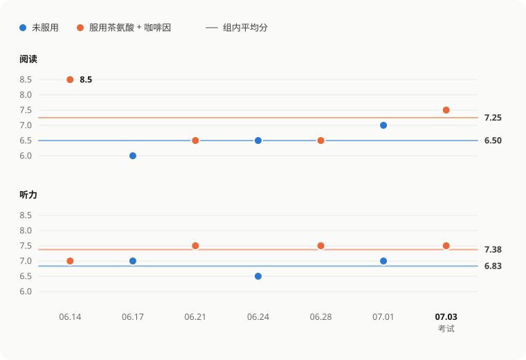

# 邪修提升专注力：茶氨酸与咖啡因在雅思场景中的个人观察

> **太长不看版**：我记录了 7 次雅思听力和阅读的成绩，其中 4 次服用了茶氨酸加咖啡因，3 次什么都没吃，最后一次是正式考试。服用的那几次，听力平均高 0.54 分，阅读平均高 0.75 分，两科合起来高 0.65 分。不过受试者只有我一个人，没有随机分组，没有盲法，也没有安慰剂对照。所以这组数据只能说明“吃了的那几天，我考得更好”，证明不了“是它让我考得更好”。

## 它大概能做什么

茶氨酸加咖啡因，可能会在短时间内让人更清醒、注意力更稳，帮我扛住雅思听力和阅读这种需要长时间集中的任务。一些随机对照研究也观察到，这个组合能让部分注意力任务的反应速度或准确率小幅提升。但效果要看具体任务和测试时间，并不是每一项指标都能稳定改善。

所以更准确的说法是：**它可能减少疲劳和注意力的起伏，间接帮你把已有的水平发挥出来；它不是提分药，也代替不了语言基础、睡眠和训练。**

## 吃了什么，怎么记的

### 用量

- 茶氨酸：每次约 200 mg，选的是常见的正规品牌。
- 咖啡因：目标约 100 mg，让茶氨酸和咖啡因大致保持 2:1。
- 咖啡因来源：Swanson 的瓜拉纳胶囊。瓜拉纳是一种天然含咖啡因的植物，胶囊里装的是它的提取物。
- 测试内容：雅思听力和阅读模考。

有一点要说在前面：瓜拉纳原料的咖啡因含量，不同批次之间可能有差异，**所以胶囊的粒数没法直接换算成准确的咖啡因剂量**。真想让实验能够复现，应该记下产品标签上标注的咖啡因毫克数，而不是只记“吃了几粒”。

### 记录

整个记录分成日常模考和考前准备两个阶段。7 次里有 4 次服用了这个组合，另外 3 次什么都没吃，作为对照。每次做的都是同类型的雅思听力和阅读题，做完记下成绩。

| 日期 | 条件 | 茶氨酸 | 瓜拉纳 | 阅读 | 听力 |
| --- | --- | ---: | ---: | ---: | ---: |
| 06.14 | 服用 | 2 粒 | 2 粒 | 8.5 | 7.0 |
| 06.17 | 未服用 | 0 | 0 | 6.0 | 7.0 |
| 06.21 | 服用 | 3 粒 | 3 粒 | 6.5 | 7.5 |
| 06.24 | 未服用 | 0 | 0 | 6.5 | 6.5 |
| 06.28 | 服用 | 2 粒 | 2 粒 | 6.5 | 7.5 |
| 07.01 | 未服用 | 0 | 0 | 7.0 | 7.0 |
| 07.03（真实考试） | 服用 | 2 粒 | 2 粒 | 7.5 | 7.5 |

## 结果

| 指标 | 服用组（4 次） | 未服用组（3 次） | 均值差 |
| --- | ---: | ---: | ---: |
| 阅读 | 7.25 | 6.50 | +0.75 |
| 听力 | 7.38 | 6.83 | +0.54 |
| 两科合并 | 7.31 | 6.67 | +0.65 |

7 次记录里，服用时两科的平均分都比不服用时高。阅读的差距更明显，听力的分数则相对稳定。图里保留了每一次的原始分数，免得只盯着平均数，忽略了单次之间的差别。

而单次之间的差别其实很大。06.14 那次阅读拿了 8.5，是 7 次里的最高分；如果把它拿掉，服用组的阅读平均分就只剩 6.83，比对照组只高 0.33。一次高分就能把均值拉动这么多，本身就说明样本实在太小。

除此之外，这些数据还排除不了好几种别的解释：每套题的难度不一样；练得多了，分数本来就会涨；睡眠、情绪和测试时间都没有控制；我自己知道当天吃没吃，可能会有期待效应。所以图表反映的只是**相关性和我的个人体验**，不是因果结论。

## 为什么可能有效

咖啡因通过阻断腺苷受体让人清醒，通常能赶走困意，但也可能带来紧张、心跳加快，或者注意力收得过窄。茶氨酸是茶叶里的一种氨基酸，有研究认为它可能缓和咖啡因带来的那种紧绷感，并改善某些注意力控制方面的指标。两者搭在一起，目的不是让人“更兴奋”，而是让清醒的状态更平稳。

现有的研究大体支持这个解释：

| 研究 | 设计与剂量 | 主要结果 |
| --- | --- | --- |
| Haskell 等，2008 | 随机双盲交叉；茶氨酸 250 mg + 咖啡因 150 mg | 部分反应速度、工作记忆和疲劳指标改善 |
| Giesbrecht 等，2010 | 44 人交叉试验；茶氨酸 97 mg + 咖啡因 40 mg | 在高注意需求任务中更容易维持专注 |
| Einöther 等，2010 | 随机双盲交叉；茶氨酸 97 mg + 咖啡因 40 mg | 任务切换表现改善，但并非所有注意指标都改善 |
| Williams 等，2025 | 系统综述与荟萃分析 | 对部分注意任务有小到中等的急性收益，结果受任务和时间影响 |

不过这些研究测的都是实验室里的认知任务，不是雅思分数。它们只能说明这个组合有可能帮助注意力表现，没法据此推出固定能提几分。

## 安全边界

1. 别在正式考试当天第一次尝试。先在同一个时间段、同样强度的模考里试一试，看看身体的反应。
2. 咖啡因可能引起失眠、焦虑、心悸、胃部不适和手抖。对咖啡因敏感的人，应该减量，或者干脆别用。
3. 美国 FDA 提到，对大多数健康成年人来说，每天 400 mg 咖啡因通常不会带来负面影响，但个体差异很大。这是安全参考上限，不是建议用量。
4. 避开纯咖啡因粉和高浓度的咖啡因液体。它们很难准确计量，一旦过量，可能造成严重伤害。
5. 孕期、有心血管疾病、焦虑或睡眠障碍，以及正在服药的人，应该先咨询医生。补充剂也不等于完全没有风险。

## 如果再做一次

如果还要继续测，我会尽量固定题目来源、测试时间、睡眠时长和饮食，提前随机排好哪天服用、哪天对照；记录实际的毫克数、主观专注程度、不良反应和成绩，并且攒下多得多的重复数据。条件允许的话，最好再用外观一模一样的安慰剂，请第三方编号，尽量减少期待效应。

对我来说，这 7 次记录值得继续谨慎地观察下去，但远远不够让我宣称这个组合一定能提分。真正稳定的分数，还是来自语言能力、限时训练和睡眠。茶氨酸和咖啡因，最多只是帮你更接近自己正常水平的上限。

## 参考资料

1. [Haskell CF, et al. The effects of L-theanine, caffeine and their combination on cognition and mood. *Biological Psychology*. 2008.](https://pubmed.ncbi.nlm.nih.gov/18006208/)
2. [Giesbrecht T, et al. The combination of L-theanine and caffeine improves cognitive performance and increases subjective alertness. *Nutritional Neuroscience*. 2010.](https://pubmed.ncbi.nlm.nih.gov/21040626/)
3. [Einöther SJL, et al. Effects of L-theanine and caffeine on attention and task switching. *Appetite*. 2010.](https://pubmed.ncbi.nlm.nih.gov/20079786/)
4. [Williams JL, et al. The Cognitive Effects of L-Theanine and Caffeine: A Systematic Review and Meta-Analysis. 2025.](https://pubmed.ncbi.nlm.nih.gov/40314930/)
5. [U.S. Food and Drug Administration. Spilling the Beans: How Much Caffeine is Too Much?](https://www.fda.gov/consumers/consumer-updates/spilling-beans-how-much-caffeine-too-much)
